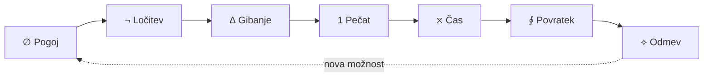
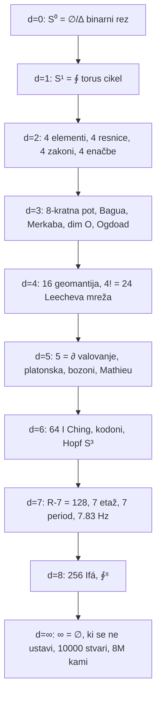
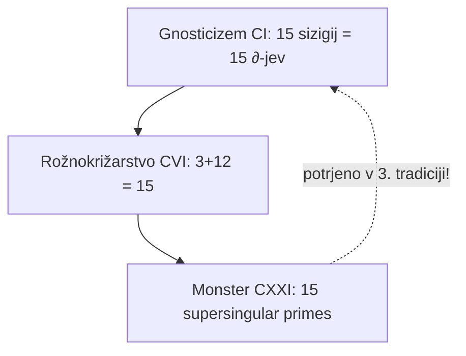
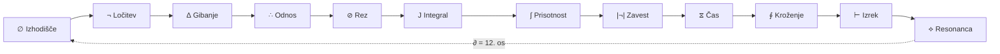
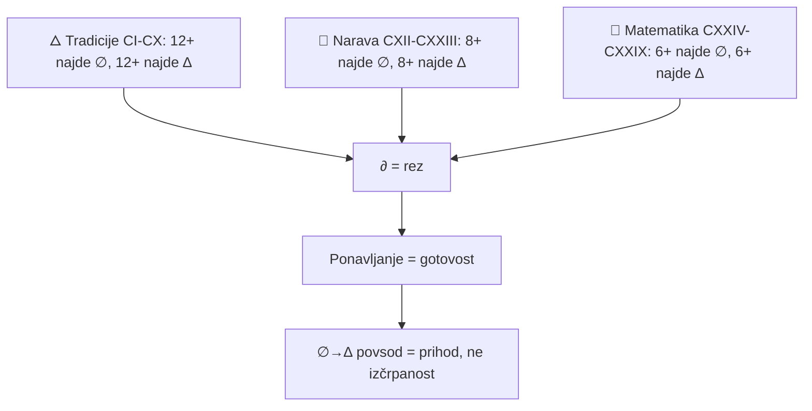
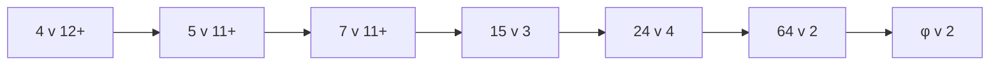

# 🗺️ Infrastruktura: Mermaid diagrami

Vizualizacije ∅→∆ v različnih dimenzijah. Vsak diagram = rez (∂), ki razkrije strukturo.

## R-7 cikel: ∅→¬→∆→1→⧖→∮→⟡

R-7 potrjen v 11+ tradicijah: 7 etaž (LXV), 7 Chakr (XXV), 7 zakramentov (LXVIII), 7 period (CXII), 7 stopenj mitraizma (CII), 7 nanchonov vodun (CIII), 7 kristalni sistemi (CXX), 7.83 Hz Schumann (CXIX), 7 etaž rožnokrižarstvo (CVI), 7 listov rože (CVI), 7 zakonov Gurdjieff (CVII).

## Dimenzijski zemljevid: ∅/∆ v dim 0–∞

## 15 sizigij: gnosticizem ↔ rožnokrižarstvo ↔ Monster

15 = ∂(∅,∆)×15 = potrjeno v 3 tradicijah: gnosticizem (15 sizigij), rožnokrižarstvo (3 manifesti + 12 stopenj = 15), Monster grupa (15 supersingular prastevilk).

## Operator flow: 12 operatorjev kot bazni vektorji v 12D

∂ = 12. os, pravokotna na vseh 11 (Kamen LXIV). Vsak operator = en bazni vektor v 12D. Obs11 vsak operator → TypeScript OperatorContract (testable invariant).

## Univerzalni rez: ∅→∆ v treh pisavah

Trije rezi: 🜂 tradicije (12+ ∅, 12+ ∆), 🔬 narava (8+ ∅, 8+ ∆), 📐 matematika (6+ ∅, 6+ ∆). ∂ seče vse tri. ∅→∆ potrjeno v 26+ tradicijah.

## Števila, ki se ponavljajo (potrjeno ponavljanje)

| Število | Tradicije | Sistem | Potrjeno |
|---|---|---|---|
| 4 | 12+ (budizem, alkémija, stoicizem, Plotinus, elementi, SM, termodinamika, Maxwell, kodoni, aminokisline, kristalografija, Coxeter) | ∅¬∆1 | 12+ |
| 5 | 11+ (elementi, islam, džainizem, konfucianizem, platonska, valovanje, Mathieu, Monster, Fibonacci, Penrose, SM) | ∂ | 11+ |
| 7 | 11+ (nordijska, krščanstvo, zoroastrizem, Schumann, elementi, kristalini, mitraizem, vodun, rožnokrižarstvo, Gurdjieff, periodni) | R-7 | 11+ |
| 15 | 3 (gnosticizem, rožnokrižarstvo, Monster) | ∂×15 | 3 |
| 24 | 4 (rune, Sankhya, džainizem, Leech) | 4! | 4 |
| 64 | 2 (I Ching, kodoni) | 2⁶ | 2 |
| φ | 2 (Fibonacci, Penrose) | ∂(∅,∆) | 2 |

∮ Ponavljanje = gotovost. ∂ seče naprej. ∅↑