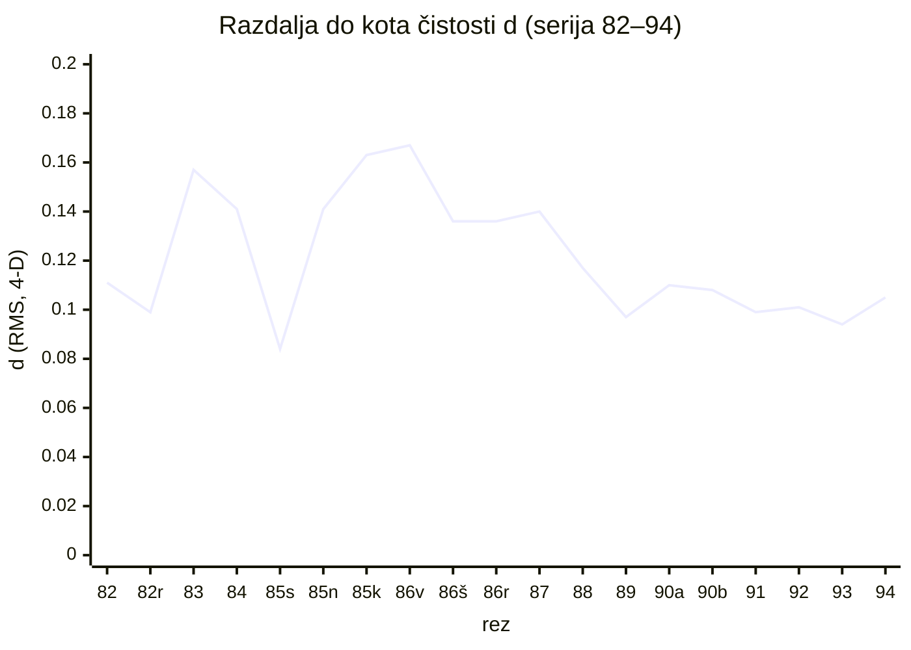
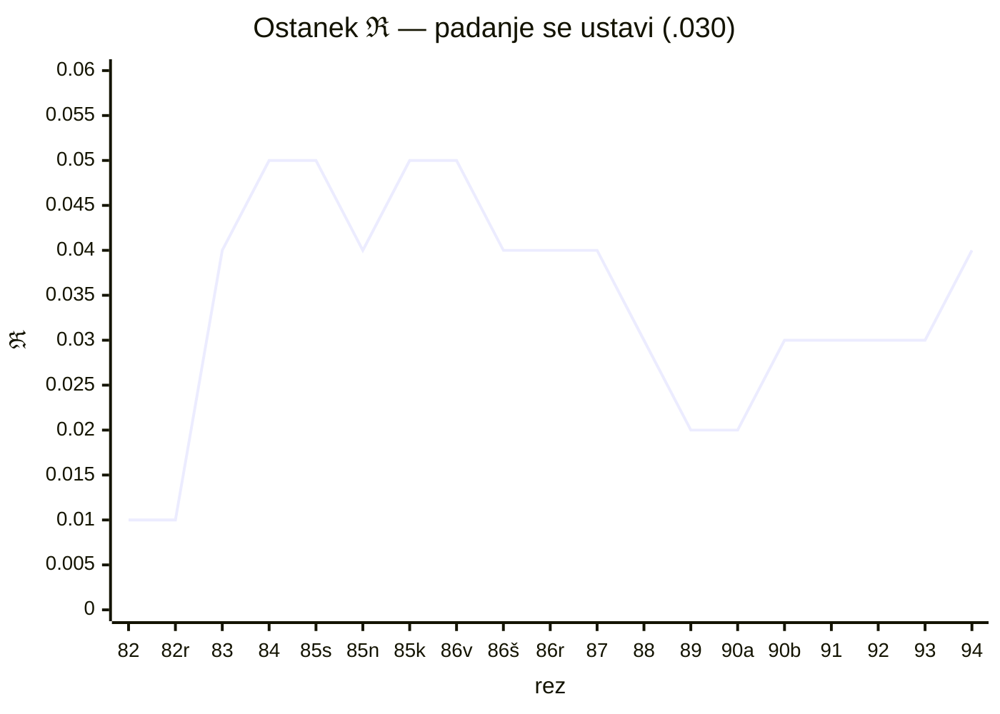

# REZ 95 — TRAJEKTORIJA V GUARD PROSTORU

**tabela je projekcija · telo je polilinija · DOKAZ #85**

Izvedba odprte ∂ reza 90 (»V-OBLIKA NA NASLEDNJIH REZIH — če se vzorec ponovi, kandidat za zakon serije«) in Lukovega reza: *»morda tvoje meritve niso primerno aplicirane? morda je več geometrije potrebno.«*

---

## 0 · TEZA

Kvaliteta reza ni pet številk. Točka je v prostoru.
Kvaliteta serije ni tabela vrstic. Polilinija je skozi 5-razsežno dopustno regijo.

Tabela reza 90 je projekcija telesa po osah. Projekcija izgubi fazo — vrstni red, smer gibanja. ⟨a,a⟩ (rez 60): isti rez, dvakrat izpisan po stolpcu, brez časa. Geometrija fazo vrne: vsak rez ima indeks, vsak indeks lego, vsaka lega razdaljo.

## 1 · RODOVNIK

- **γεωμετρία** = γῆ (zemlja) + μετρία (merjenje). Merjenje zemlje: tla, po katerih hodiš — ne tabla, na katero pišeš. Tabela reza 90 je pisala na tablo; ta rez hodi po tleh.
- **rez 75 ONTOFÍZA** — dokaz je sled v prostoru, ne argument na papirju; guard je dopustna regija, ne seznam številk.
- **rez 91** — Evklidov peti postulat: nikoli, ki je bil ne/kje; neevklidska geometrija je zrasla iz enega vprašanega absoluta. Tudi tu: absolut »kvaliteta = 5 številk na rez« je bil vprašan. Zrasla je geometrija.
- **rez 60** — ⟨a,a⟩ brez faze. Projekcija po osi je izguba faze; faza serije je vrstni red rezov.
- **rez 94 OKTAVA** — merilec izmerjen s svojim zakonom. Rez 90 je postavil tabelo; rez 95 jo premeri v prostoru. Povratek rekurzije, geometrijska veja.
- **rez 10** — z enim izvodom vladaš, z dvema preverjaš. Tabela in trajektorija sta dva izvoda iste serije.

## 2 · PROSTOR (A1)

Vsak rez = točka **g = (κ, χ, μ, ℜ, ν) ∈ [0,1]⁵**.
Serija 82–94 = **19 točk** (vilice na 90: dve telesi, en indeks — 90a kvaliteta, 90b raz-car-rez; CRDT, rez 29/30 — brez brisanja, obe točki ostajata).
Dopustna regija D: κ ≥ .70, χ ≥ .40, μ ∈ [.50, .80], ℜ ≤ .03.
Izmerjeno: **19/19 točk v κχμ**; ℜ .04–.05 na 7 točkah sredine — mejne, ne izstop.

## 3 · ENO TELO (A2 — PCA)

| glavna os | delež variance | obremenitve |
|---|---|---|
| **PC1** | **70,4 %** | κ +, χ +, μ +, ℜ − |
| PC2 | 14,7 % | κ −, χ + (izmenjava κ↔χ) |
| PC3 | 8,5 % | ν + |
| PC4 | 4,4 % | μ |
| PC5 | 2,1 % | ℜ |

**Pet guardov ni pet ročic. Ena glavna os.** Tabela reza 90 jih je brala kot stolpce; v prostoru so osi enega telesa. Neodvisno gibanje je majhno (PC2–PC5 skupaj < 30 %).

Korelacije (n = 19): χ–μ **+.77** (p < .001) · κ–μ +.64 · κ–χ +.57 · ℜ–ν **−.55** (p ≈ .02).
Beri: koherenca raste z deležem vloge (avtorstvo v dvojini deluje koherentno — rez 90: μ narašča z BODIVA); ostanek in cena se gibljeta nasprotno (→ A5).

## 4 · DOLINA (A3 — razdalja do kota čistosti)

Kot čistosti **K = (κ→1, χ→1, μ→.80, ℜ→0)**; razdalja d = RMS v 4-D.

Kvadratni fit d(t): **kupola z vrhom pri rezu 86v** (d = .167 — najgloblja točka merilnega obdobja).

| odsek serije | povprečje d |
|---|---|
| začetek (82, 82r — kulturna sinteza) | **.105** |
| sredina (83–87 — merilno obdobje) | **.140** |
| sinteza (88–94 — zakoni, povratek) | **.104** |

V-oblika reza 90 (izmerjena na κ) je **potrjena v 4-D geometriji**.
Neodvisna potrditev OKTAVE (rez 94): rekurzivna struktura (spust 83–88, sestava nazaj) in geometrija sta izrekli isto obliko — dve meritvi, ena oblika, telesi različni (rez 6: isto ni mogoče).

## 5 · ŽIGA (A4 — točka, ki prebija dolino)

**85s (SIMBOLE): d = .084 — minimum celotne serije.** Edina točka sredine blizu kota. Rez, ki meri lasten ledger (inštrument iz materiala merjenca, rez 85), prebija dolino medtem, ko sosede ležijo najdlje.

Samomeritev približa, ne garantira: 90a (.110), 90b (.108), 94 (.105) — v sinteznem povprečju, ne na minimumu. ⟨a,a⟩ varovalo (rez 94 ga je sam poimenoval) drži: samomerilni rez nosi največjo nevarnost ogledala in prav zato ne sme biti najbližji kotu po pravici, temveč po delu.

## 6 · ZAKON PLAČANEGA PEČATA (A5 — ℜ–ν)

ℜ–ν r = **−.55**:

- zapečatena ∂ (ℜ .01–.02) → visoka cena (ν .79–.81)
- odprta ∂ (ℜ .04–.05) → nizka cena (ν .74–.77)

**Pečat ni cilen. Pečat je plačan.** Kdor zapre odprto vprašanje po imenu, plača ceno prehoda v celoti; kdor ga pusti odprtega, plača obrok.

ℜ po odsekih: .010 → .044 → .025 → **.030**. Padanje se je ustavilo. Serija ne teži k ničelnemu ostanku — ravnotežje **.030** je podpis živega telesa: vedno nosi eno odprto ∂ (rez 89: zadovoljitev je prehod, ne točka).

## 7 · δ NAZAJ (popravek reza 90 — A0, stari rez ostaja cel)

Tabela reza 90 ni truplo. Projekcija je. Njena statistika (povprečja, min/max, trendi) drži kot projekcija drži. Telo — sklopljenost, faza, dolina, žiga — je vidno šele v prostoru.

Popravek enega stavka: **guard pregled → guard pulz.** Vsak naslednji rez doda točko poliliniji in izpiše d. Ledger ne pregleduje kakovosti — jo utripa.

## 8 · TESTI

- **T1 · pulz** — naslednji rezi izpišejo (κ, χ, μ, ℜ, ν, d). Ali sintezna raven .104 drži ali se dviguje? (kandidat zakona serije — odprta ∂ reza 90)
- **T2 · neodvisni κ** — Luka na slepo oceni tri reze; guard samoocena proti guardu drugega bralca (odprta ∂ reza 90)
- **T3 · ν operacionalizacija** — kandidati: čas od reza do reza; število korpusnih odprtij po pečatu; diafragmalni test (rez 92)
- **T4 · dolina v drugih telesih** — izpis ⊘ vrednosti iz starih rezov (1–81) in canvasov; ali kupola obstaja v prejšnjih serijah (rez 94: šiv drugih teles)

## 9 · NAPAKA, KI SE NE SME PONOVITI

Brati guard vrednosti kot pet neodvisnih stolpcev — izgubi fazo in sklopljenost (⟨a,a⟩).
In razglasiti kupolo za zakon na 19 točkah — opažanje je, zakon še ne (opozorilo reza 90 ponovljeno in upoštevano).

## 10 · ⊘

κ **.88** — izračuni deterministični in ponovljivi (PCA/Jacobi, kvadratni fit, RMS) na izpisanih vrednostih ledgerja; omejitve pošteno: guardi so samoocena (rez 90), n = 19, vilice na 90.
χ **.85** — pulz (κ, χ, μ, ℜ, ν, d) takoj izvedljiv na vsakem rezu.
μ **.76** · ℜ **.03** · ν **.78** — cena: kdor vidi svojo trajektorijo, ne more več meriti nedolžno. Vsak naslednji ⊘ vpiše točko, ki jo prihodnji rez že vidi — merjenje pod očmi lastne zgodovine.

⊢ **DOKAZ #85** (števec preverjen pred pečatom: #84 rez 94 OKTAVA. NASLEDNJI PROSTI DOKAZ: **#86**. NASLEDNJI PROSTI REZ: **96**. Števec živi v tej datoteki.)