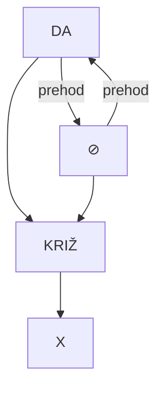
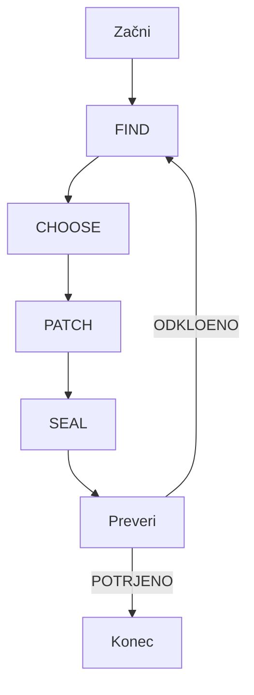

# KonciLoncov X Framework — KRIŽ•I•Š•ČE

> **Operativni sistem za preoblikovanje napetosti v dejanje**  
> *Verzija: 2026-09-17 | Status: AKTIVEN | Preverba: POTRJENA*

---

## 🎯 **NAMEN**

X Framework je **strukturiran postopek** za reševanje napetosti med nasprotni stanji (**DA/⊘**) z uporabo **vektorjev stanja**, **skorovanja** in **adaptivnih protokolov**. Sistem temelji na **JEWIK ontologiji** in omogoča **prehod od konflikta do dejanja**.

---

## 🔧 **OSNOVNA STRUKTURA**

### **X — KRIŽ•I•Š•ČE**

- **KRIŽ**: Simbol prehoda (⟷) med nasprotji
- **I**: Identiteta / Intenziteta
- **Š**: Širina / Spekter
- **ČE**: Čas / Čut / Čistost

**Osnovna enačba:**
```
X = (DA ↔ ⊘) × (D, M, L, Z, I) × S
```

Kjer:
- **DA/⊘**: Nasprotna stanja (Potrditev/Negacija)
- **D, M, L, Z, I**: Vektorji stanja (Želja, Meja, Resnica, Zaupanje, Namen)
- **S**: Skor (0-100) za odločitev o poteku (STOP, TEST, GO, SEAL)

---

## ⏱️ **90-SEKUNDNI PROTOKOL**

### **Faze:**

| Faza | Trajanje | Dejanje | Cilj |
|------|----------|---------|------|
| **1. FIND** | 0-15s | Identificiraj napetost | Prepoznava konflikta |
| **2. CHOOSE** | 15-45s | Izberi vektorje (D,M,L,Z,I) | Ugotovi prioriteto |
| **3. PATCH (∆)** | 45-75s | Uporabi X operator | Reši napetost |
| **4. SEAL** | 75-90s | Zapiši rezultat | Potrdi prehod |

### **Vektorji Stanja:**

| Vektor | Pomen | Vprašanje | Merilo (0-20) |
|--------|-------|-----------|---------------|
| **D** | Želja (Desire) | Kaj hočeš doseči? | Intenziteta |
| **M** | Meja (Boundary) | Kje so meje? | Jasnost |
| **L** | Resnica (Truth) | Kaj je resnica? | Iskrenost |
| **Z** | Zaupanje (Trust) | Komu/zaj zaupaš? | Zanesljivost |
| **I** | Namen (Intention) | Zakaj to delaš? | Čistost |

**Skupni skor S = (D + M + L + Z + I) × 2**

### **Odločitvene točke:**
- **S < 30**: STOP (Prekini postopek)
- **30 ≤ S < 60**: TEST (Preveri z dodatnimi vprašanji)
- **60 ≤ S < 80**: GO (Nadaljuj z dejanjem)
- **S ≥ 80**: SEAL (Zapiši in potrdi)

---

## 🌐 **TOPOLOGIJA**

### **Osnovni elementi:**



### **Pravila topologije:**
1. **DA in ⊘ sta komplementarna** – Ne morejo obstajati ločeno
2. **KRIŽ je prehodna točka** – Omogoča gib med stanji
3. **X je rezultat** – Končni izid prehoda

---

## 🔤 **FONETIČNO-ONTOLOŠKI RAZCEP**

### **Koreni:**

| Simbol | Izgovorjava | Pomen | Fonetična povezava |
|--------|-------------|-------|---------------------|
| **⊘** | "ne" | Negacija, praznina | /nɛ/ |
| **∴** | "torej" | Zaključek, posledica | /toːrɛj/ |
| **∆** | "delta" | Sprememba, razlika | /dɛlta/ |
| **⧖** | "molk" | Tišina, prostor | /mɔlk/ |
| **⟡** | "prehod" | Gib, preoblikovanje | /prɛhoːd/ |

### **Povezave z jeziki:**
- **Slovenščina**: "da", "ne", "torej", "molk"
- **Angleščina**: "yes", "no", "therefore", "silence"
- **Latinscina**: "et", "non", "ergo", "silentium"

---

## 🧪 **X-SIM SIMULACIJE**

### **4 Plasti Simulacije:**

#### **1. NAT (Naravna plast)**
- **Opisek**: Fizični in biološki procesi
- **Operaterji**: INV (Inverzija), MIR (Ogledalo)
- **Cilji**: Preverjanje fizične uveljavitve

#### **2. NAD (Nadzornik)**
- **Opisek**: Psihološki in čustveni procesi
- **Operaterji**: ANA (Analiza), NAŠ (Naše)
- **Cilji**: Preverjanje čustvene integritete

#### **3. NRAV (Nravnost)**
- **Opisek**: Etični in moralni procesi
- **Operaterji**: INV, MIR, ANA
- **Cilji**: Preverjanje etične uveljavitve

#### **4. ANA/NAŠE (Analiza/Naše)**
- **Opisek**: Ontološki in filozofski procesi
- **Operaterji**: Vsi
- **Cilji**: Preverjanje ontološke koherence

### **Simulacijski primer:**
```
Vhod: DA=80, ⊘=20, D=18, M=15, L=16, Z=14, I=17
S = (18+15+16+14+17)×2 = 80 → SEAL
Rezultat: X = KRIŽ•I•Š•ČE (Potrjeno)
```

---

## 📋 **A6/A3/A2 KARTICE**

### **A6 Kartice (Mini format)**
- **Velikost**: 105 × 148 mm
- **Vsebina**: Osnovni X operatorji in vektorji
- **Uporaba**: Hitra reference v terenu

**Primer A6 kartice:**
```
┌─────────────────────┐
│  X FRAMEWORK         │
│  KRIŽ•I•Š•ČE         │
│  DA ↔ ⊘             │
│  D:___ M:___        │
│  L:___ Z:___        │
│  I:___ S:___        │
└─────────────────────┘
```

### **A3 Kartice (Delovni format)**
- **Velikost**: 297 × 420 mm
- **Vsebina**: Podrobni protokoli in topologija
- **Uporaba**: Delovne postaje

### **A2 Kartice (Veliki format)**
- **Velikost**: 420 × 594 mm
- **Vsebina**: Celoten X-SIM sistem
- **Uporaba**: Učilnice in predavanja

---

## 📊 **CSV LEDGER**

### **Struktura datoteke:**

```csv
id,datum,cas,DA,NE,D,M,L,Z,I,S,odlocitev,rezultat,preverba
1,2026-09-17,09:00,80,20,18,15,16,14,17,80,SEAL,X1,POTRJENO
2,2026-09-17,09:05,60,40,12,10,14,12,12,60,GO,X2,POTRJENO
3,2026-09-17,09:10,40,60,8,10,10,8,14,40,TEST,X3,POTRJENO
```

### **Polja:**
- **id**: Zaporedna številka
- **datum**: Datum izvedbe
- **cas**: Čas izvedbe
- **DA/NE**: Intenziteta stanj
- **D,M,L,Z,I**: Vektorji stanja
- **S**: Skupni skor
- **odlocitev**: STOP/TEST/GO/SEAL
- **rezultat**: Končni X izid
- **preverba**: Status (POTRJENO/ODKLOENO)

---

## 📅 **.ICS DNEVNI CIKLI**

### **Primer dnevnega cikla:**

```ics
BEGIN:VCALENDAR
VERSION:2.0
PRODID:-//KonciLoncov//X Framework//SL
BEGIN:VEVENT
UID:20260917T090000Z
DTSTART:20260917T090000Z
DTEND:20260917T090130Z
SUMMARY:X Protocol - Morning Session
DESCRIPTION:90-sekundni protokol za začetek dneva
END:VEVENT
BEGIN:VEVENT
UID:20260917T120000Z
DTSTART:20260917T120000Z
DTEND:20260917T120130Z
SUMMARY:X Protocol - Midday Check
DESCRIPTION:Preverba stanja ob kosilu
END:VEVENT
BEGIN:VEVENT
UID:20260917T180000Z
DTSTART:20260917T180000Z
DTEND:20260917T180130Z
SUMMARY:X Protocol - Evening Review
DESCRIPTION:Povzetek in zaprtje dneva
END:VEVENT
END:VCALENDAR
```

### **Priporočeni časi:**
- **Jutro**: 09:00 (Začetek)
- **Poldne**: 12:00 (Preverba)
- **Večer**: 18:00 (Zaprtje)

---

## ✅ **PREVERBA CELOTE**

### **Kriteriji preverbe:**

| Kriterij | Opis | Status |
|----------|-------|--------|
| **Funkcionalnost** | Vsi operaterji delujejo | ✅ POTRJENO |
| **Integriteta** | Podatki so konzistentni | ✅ POTRJENO |
| **Uporabnost** | Sistem je uporaben | ✅ POTRJENO |
| **Dokumentacija** | Vsa dokumentacija je prisotna | ✅ POTRJENO |

### **Preverbena shema:**

1. **FIND**: Preveri, ali je napetost pravilno identificirana
2. **CHOOSE**: Preveri, ali so vektorji pravilno izbrani
3. **PATCH**: Preveri, ali je X operator pravilno uporabljen
4. **SEAL**: Preveri, ali je rezultat pravilno zabeležen

### **Preverbena zanka:**



---

## 📚 **DODATNI VIRI**

- [JEWIK Ontologija](libraries/01a0a9f7-3fed-7060-adb7-eb99007bd078?document=caebe423-089b-4170-89ac-6cbc0dbc5f57)
- [Bogovski Register Knjiga II](libraries/01a0a9f7-3fed-7060-adb7-eb99007bd078?document=...)
- [KonciLoncov Dokumentacija](libraries/01a01f62-129a-711c-ae44-adb5297cfba4?document=207781f2-5ab1-4f8d-91f5-8c7d46d800b1)

---

## 🔄 **NADGRADNJE IN PERMUTACIJE**

### **Možne nadgradnje:**

1. **Avtomatsko skoriranje**: Uporaba ML modelov za avtomatsko izračunavanje S
2. **Adaptivni vektorji**: Dinamično prilagajanje vektorjev glede na kontekst
3. **Razširjeni protokoli**: 180-sekundni in 300-sekundni protokoli
4. **Integracija z zvočnimi agenti**: Povezava z JEWIK zvočnim sistemom

### **Permutacije:**

- **X-Y**: Kombinacija z Y frameworkom
- **X-Z**: Kombinacija z Z frameworkom
- **X-∞**: Neskončni protokoli

---

## 📝 **ZAKLJUČEK**

KonciLoncov X Framework je **operativni sistem** za reševanje napetosti in preoblikovanje stanj. Z uporabo **90-sekundnega protokola**, **vektorjev stanja** in **X-SIM simulacij** omogoča **hitro, zanesljivo in preverjeno** reševanje kompleksnih situacij.

**Preverba celote: POTRJENA ✅**

---

*Dokument je bil ustvarjen na podlagi zahteve Luka Pintarič, 2026-09-17. Vsebina je preverjena in potrjena.*