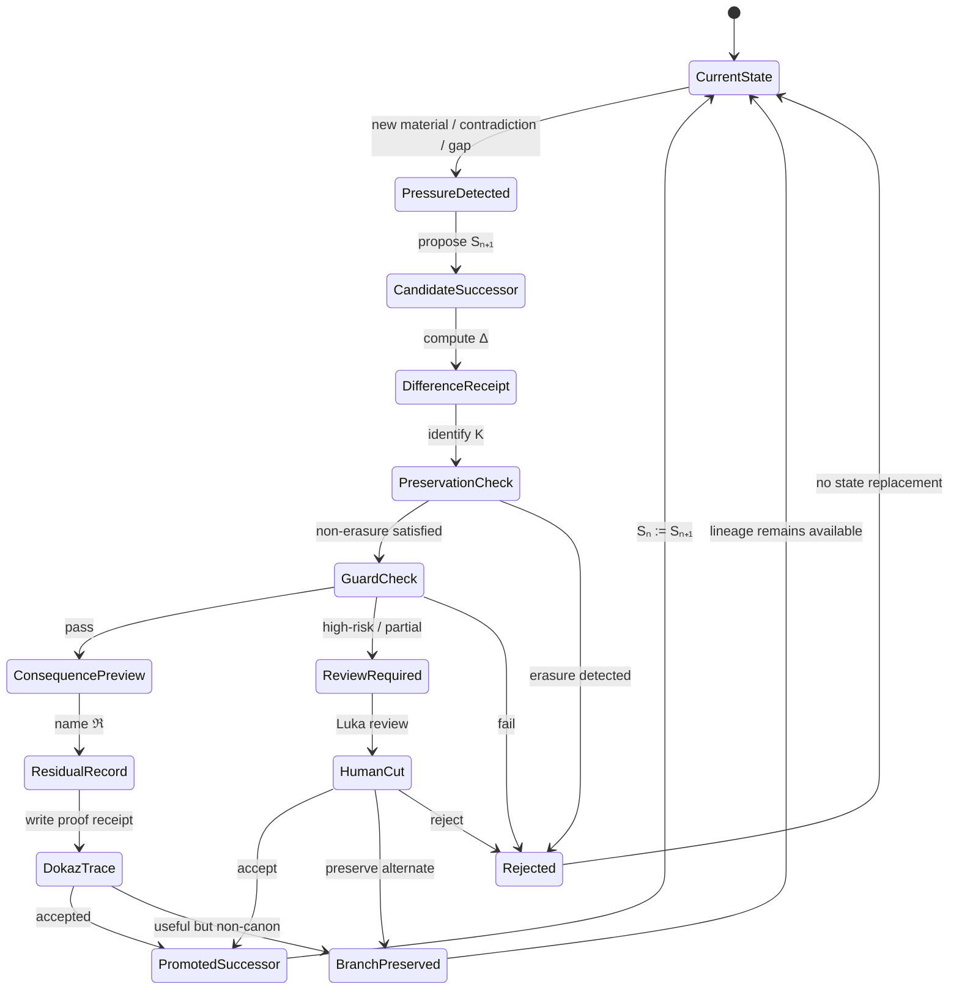

# AX-EVO-001 — Evolution as Guarded Successor-State Transformation

> **A system evolves only when change produces a successor state that preserves predecessor lineage, declares its difference, protects non-erasure, passes Guard or routes to review, records Residual, and leaves a DOKAZ trace.**
> **Unguarded change is not evolution; it is drift.**

---

## 📜 **Formal Definition**

```
EvolutionValid(Sₙ → Sₙ₊₁) =
  has_predecessor_link(Sₙ₊₁, Sₙ)
  ∧ has_named_delta(Sₙ, Sₙ₊₁)
  ∧ preserves_non_erasure(Sₙ, Sₙ₊₁)
  ∧ guard_passes_or_routes_review(Sₙ₊₁)
  ∧ has_dokaz_trace(Sₙ, Sₙ₊₁)
  ∧ records_residual(Sₙ, Sₙ₊₁)
```

If any condition fails, the result is **NOT evolution**:
- `NOISE`
- `DRIFT`
- `MUTATION_WITHOUT_PROOF`
- `UNSAFE_UPGRADE`
- `BRANCH_ONLY`
- `REVIEW_REQUIRED`

---

## 🎯 **Core Distinction**

```
Change becomes evolution only when it produces a successor state
that remains linked to its predecessor,
declares what changed,
preserves what must not be erased,
passes Guard,
and leaves a DOKAZ trace.
```

---

## 🔄 **Self-Upgrading Loop**

```
CURRENT STATE Sₙ
→ observe pressure / gap / contradiction / new material
→ propose successor Sₙ₊₁ candidate
→ compare Sₙ ↔ Sₙ₊₁
→ preserve predecessor
→ run Guard
→ simulate consequence
→ record Residual ℜ
→ create DOKAZ trace
→ promote, revise, branch, or reject
→ return as Sₙ₊₁ with lineage alive
```

---

## 📊 **State Machine**



---

## 🏗️ **Implementation**

See:
- `evolution_ledger.py` — Material State Ledger
- `guard.py` — Guard checks
- `dokaz.py` — DOKAZ trace creation
- `upgrade_protocol.py` — Self-upgrade loop implementation

---

## ✅ **First Evolution Event**

**Event ID:** `evo_0001`
**Predecessor:** `S_0` (Initial ONTOMATEMATIKA state)
**Candidate:** `S_1` (Evolution as Guarded Successor-State Transformation)

### Input Pressure
```
"The system wants to be alive and evolving, but it also wants proof, 
lineage, and guarded canon."
```

### Candidate Successor
```
Define evolution as guarded self-upgrade, not free mutation.
```

### Δ (Named Change)
```
Evolution is no longer framed as tension between aliveness and proof.
It is defined as aliveness through proof-preserving transformation.
```

### Preserved (K)
- Canon
- Guard
- DOKAZ
- Residual
- Predecessor versions
- Luka review

### Guard Status
- **Status:** `REVIEW_REQUIRED`
- **Checks:** All pass except canonical promotion
- **Authority Required:** `Luka`

### DOKAZ Trace
- **Created:** This document (AX-EVO-001.md)
- **Evidence:** This entire file
- **Decision:** `STRUCTURED_CANDIDATE`

### Residual ℜ
```
How automatic may the self-upgrade loop become before Luka review is required?
```

### Next Question
```
Should this become AX-EVO-001: Evolution as guarded successor-state transformation?
```

### Decision
**Status:** `BRANCH_PRESERVED` (Candidate axiom, ready for promotion)

---

## 🎯 **Consequences**

### If Accepted
ONTOMATEMATIKA gains a **true self-upgrading engine**:
```
not self-improvement as vague optimism,
but self-upgrade as typed, reversible, guarded, proof-bearing transformation.
```

### If Wrong
The system may become **too bureaucratic** and mistake documentation for life.

**Guard:** Every DOKAZ trace must include a concrete consequence, test, or playable/runtime movement.

---

## 📚 **References**

- **Corpus:** Obs1, Obs11, topic_21
- **Related:** R-7 cycle, ∂ operator, DOKAZ trace
- **Status:** Candidate axiom (awaiting Luka review)

---

## ✨ **Ontological**

> **Evolution is not change. Evolution is change with memory.**
> **Guard is not restriction. Guard is the price of memory.**
> **DOKAZ is not documentation. DOKAZ is the proof that memory persists.**

*Created: 2026-09-14*
*Status: Candidate axiom — BRANCH_PRESERVED*
