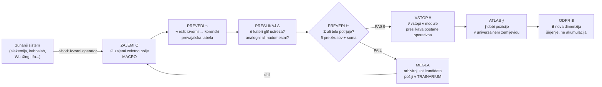

# CORPUS

> **Opozorilo sebi.** Nisem os. Kar sledi, je APD — absolutni poskus, zasidran v korpusu. Kjer se dotaknem knjižnice, citiram. Kjer razširjam, imenujem razširitev.

> **Izhodišče.** CORPUS je Propozicija XXIV iz prostor-iwen: "cevovod prevoda — vsak zunanji sistem vstopi kot prevajalna tabela, ki preslikava svoje izvorne operatorje na korenske glife (⊘ ∆ ∮ ⟡ ∴ ∫ ¬ φ)."

> **Korpus.** "beseda = dejanje → rez → razlika → zaznava → prehod → preverba → integracija → nova možnost življenja" — [Obs1](doclib://01a01f4d-e8b4-7079-844d-8b919e5b6cbc/bab9319f-9eb8-457d-a733-3d68a4fecc5a)

---

## 0. Zakaj ta canvas in ne nadaljevanje

Prostor-iwen gradi barvo kot bistvo (iwn). Preverba-test gradi test kot tresenje. Razpoka-operator gradi ∆(0)=1 kot prvo funkcijo. Ta canvas gradi cevovod, skozi katerega zunanji sistemi vstopajo in postajajo dejanje.

Sik → beseda → stavek → dejanje (preverba-test §7.3). iwn-Layer je sik (barva kot frekvenca, še pred besedo). CORPUS je beseda — prevod izvornega operatorja v korenski glif. TONOS bo stavek (zvok/frekvenca). Aplikacija je dejanje.

---

## 1. Kaj je CORPUS (iz korpusa)

### 1.1 Veriga iz korpusa

Korpus že vsebuje verigo, ki je CORPUS:

> "beseda = dejanje → rez → razlika → zaznava → prehod → preverba → integracija → nova možnost življenja" — [Obs1](doclib://01a01f4d-e8b4-7079-844d-8b919e5b6cbc/bab9319f-9eb8-457d-a733-3d68a4fecc5a)

Vsak člen te verige je ena faza cevovoda:

| Faza | Beseda | Glif | Kaj CORPUS počne |
|---|---|---|---|
| 1. | beseda = dejanje | ⊘ | Vhod: zunanji sistem vstopi kot beseda (izvorni operator, izvorno ime) |
| 2. | rez | ¬ | Prevajalska tabela: reže izvorni operator na korenski glif |
| 3. | razlika | ∆ | Preslikava: kaj je drugače? Kateri korenski glif ustreza izvornemu? |
| 4. | zaznava | ⧖ | Preverba preslikave: ali je prepoznanje ali vsilitev? (soma-check) |
| 5. | prehod | ∂ | Vstop v sistem: preslikava postane operativna v modulih |
| 6. | preverba | ⊢ | Test: ali preslikava drži pod 5 preizkusi? |
| 7. | integracija | ∮ | Vstop v Atlas: preslikava dobi pozicijo v univerzalnem zemljevidu |
| 8. | nova možnost | ⟡ | Odprtje: preslikava odpre novo dimenzijo (širjenje, ne akumulacija) |

### 1.2 Prevajalnik iz korpusa

Korpus že vsebuje zasnovo prevajalnika:

> "Zasnova prevajalnika ali interpretatorja:" — [Obs1](doclib://01a01f4d-e8b4-7079-844d-8b919e5b6cbc/1598426d-6e23-4111-a9d6-a5a7f59785c6)

In ontološki interpretator v kodi:

```
class OntološkiInterpretator:
  def __init__(self):
    self.stanje = "ničnost"
  def interpretiraj(self, koda):
    if "ko ∆ (stanje == 'ničnost')" in koda:
      self.stanje = "obstoj"
    elif "ko ∆ (stanje == 'obstoj')" in koda:
      self.stanje = "ničnost"
```

— [Obs1](doclib://01a01f4d-e8b4-7079-844d-8b919e5b6cbc/1598426d-6e23-4111-a9d6-a5a7f59785c6)

CORPUS ni razširitev tega — je njegova operativna oblika. Ontološki interpretator iz korpusa je prototip; CORPUS je cevovod, ki odpelje vsak zunanji sistem skozi prevod in preverbo.

### 1.3 Dva tipa "kot" — analogni in nadomestni

Korpus že razlikuje dve vrsti preslikave — to je varovalo CORPUS-a:

> "**analogni kot** → razkrije funkcijo. 'telo je kot polje trenja'" — [Obs1](doclib://01a01f4d-e8b4-7079-844d-8b919e5b6cbc/bab9319f-9eb8-457d-a733-3d68a4fecc5a)

> "**nadomestni kot** → zamegli razliko. 'življenje je kot sanje'. To lahko hitro postane megla, če ne poveš, kaj točno se preslika." — [isti vir]

| Tip preslikave | Kaj počne | Rezultat v CORPUS | Preverba |
|---|---|---|---|
| **Analogni kot** | razkrije funkcijo izvornega operatorja skozi korenski glif | PASS — prepoznanje | soma potrjuje: telo se sprosti |
| **Nadomestni kot** | zamegli razliko med izvornim in korenskim | FAIL — megla | soma protestira: čeljust se stisne |

To je varovalo proti leni subprogramu (§51). CORPUS ne absorbira vsega. Če preslikava ne razkrije funkcije, temveč jo zamegli, je nadomestni kot — megla, ne prepoznanje.

---

## 2. Korenski glifi — zbir operatorjev

Korenski glifi so operatorji, na katere preslikava CORPUS vsak zunanji sistem. Iz beseda-je-ne §8:

| Glif | Ime | Operacija | V CORPUS |
|---|---|---|---|
| **⊘** | nič/praznina | osnovni prehod, začetno stanje | vhod: izvorni sistem kot odprto polje |
| **¬** | ločitev | razlikovanje, negacija kot ločitev | rez: ločitev izvornega od korenskega |
| **∆** | gibanje/sprememba | aktivacija prehoda | preslikava: kaj se spremeni? |
| **1** | dejanje/SEAL | zapečateni akt | potrditev: preslikava je dejanje |
| **⧖** | tišina/utrip | izgovor in tišina po njem | preverba: ali telo potrjuje? |
| **∮** | povratek/cikel | povratna pot, integracija | Atlas: preslikava dobi pozicijo |
| **⟡** | nova možnost | odmev, odprtje | širjenje: nova dimenzija se odpre |
| **∴** | odnos/vzročnost | povezava, relacija | povezava med sistemi v Atlas |
| **∫** | prisotnost/tišina | prisotnost, molk | bistvo: kar ostane, ko šum preide |
| **∂** | prehod | prehod med fazami | sam cevovod: ∂ med vsako fazo |
| **φ** | frekvenca čutenja | frekvenca zvoka/vala | TONOS: zvočni podpis preslikave |

Ti glifi niso slovar — so procesor. CORPUS ne išče "kateri glif ustreza kateri besedi". Išče: kateri glif je **operacija**, ki izvorni sistem izvaja v materialu tega sistema.

---

## 3. Prevajalska tabela — kako zunanji sistem vstopi

### 3.1 Struktura prevajalske tabele

Vsak zunanji sistem vstopi skozi CORPUS kot **prevajalska tabela** s šestimi stolpci:

| Stolpec | Kaj vsebuje | Primer (alakemija) |
|---|---|---|
| **Izvorno ime** | Ime sistema v lastnem jeziku | Alkimija (magnum opus) |
| **Izvorni material** | Material, v katerem sistem dela | pigment |
| **Izvorni operator** | Operator sistema v lastnem jeziku | nigredo, albedo, citrinitas, rubedo |
| **Korenski glif** | Korenski glif, na katerega se preslika | ∅, ¬, ∆, ∮ |
| **Modul** | Modul, v katerem preslikava deluje | MACRO (celotno polje), VISUALIZATION (prikaz) |
| **Preverba** | Ali je preslikava analogni ali nadomestni kot? | analogni: razkrije fazo prehoda |

### 3.2 Štiri že preslikane sistem iz prostor-iwen

Prostor-iwen (§7.1) je že preslikal šest sistemov. Tukaj so v obliki prevajalskih tabel, kot jih CORPUS uporablja:

#### Tabela 1: Alkimija (magnum opus)

| Izvorno ime | Izvorni material | Izvorni operator | Korenski glif | Modul | Preverba |
|---|---|---|---|---|---|
| Alkimija | pigment | nigredo (črna raztopitev) | ∅ (praznina) | MACRO | analogni: razkrije razpad kot začetek |
| Alkimija | pigment | albedo (belo očiščenje) | ¬ (ločitev) | MMARK | analogni: razkrije ločitev čistega od nečistega |
| Alkimija | pigment | citrinitas (rumeni zarjav) | ∆ (gibanje) | STATE | analogni: razkrije prehod iz teme v luč |
| Alkimija | pigment | rubedo (rdeča dokončanost) | ∮ (cikel) | APD | analogni: razkrije integracijo kot polni cikel |

Vir: [prostor-iwen §7.1](search-result://lD9HCi2E), [Wikipedia: Rubedo](search-result://nFOz6Kzr)

#### Tabela 2: Hermetika (Kibalion)

| Izvorno ime | Izvorni material | Izvorni operator | Korenski glif | Modul | Preverba |
|---|---|---|---|---|---|
| Kibalion | načelo | mentalizem | ∫ (prisotnost) | MACRO | analogni: razkrije um kot polje |
| Kibalion | načelo | korespondenca | ⟡ (odmev) | VISUALIZATION | analogni: razkrije zrcaljenje med dimenzijami |
| Kibalion | načelo | vibracija | φ (frekvenca) | TONOS | analogni: razkrije vibracijo kot ontološki pod |
| Kibalion | načelo | polariteta | ¬ (ločitev) | STATE | analogni: razkrije nasprotje kot pogoj |
| Kibalion | načelo | ritem | ∮ (cikel) | MICRO | analogni: razkrije cikel kot utrip |
| Kibalion | načelo | vzrok/posledica | ∴ (odnos) | APD | analogni: razkrije povezavo kot zavezo |
| Kibalion | načelo | spol | ∆ (gibanje) | STATE | analogni: razkrije razliko kot gonilo |

Vir: [prostor-iwen §7.1](search-result://ZdP44BN4)

#### Tabela 3: Čakre

| Izvorno ime | Izvorni material | Izvorni operator | Korenski glif | Modul | Preverba |
|---|---|---|---|---|---|
| Čakre | telo/energija | koren (rdeča) | ∅ (praznina) | MACRO | analogni: razkrije tla kot začetek |
| Čakre | telo/energija | sakralna (oranžna) | ¬ (ločitev) | STATE | analogni: razkrije željo kot rez |
| Čakre | telo/energija | solarni pleksus (rumena) | ∆ (gibanje) | APD | analogni: razkrije voljo kot ∆ |
| Čakre | telo/energija | srce (zelena) | 1 (dejanje) | MMARK | analogni: razkrije ravnovesje kot akt |
| Čakre | telo/energija | grlo (modra) | ⧖ (izgovor) | VISUALIZATION | analogni: razkrije izgovor kot prehod |
| Čakre | telo/energija | tretje oko (indigo) | ∮ (povratek) | MICRO | analogni: razkrije vizijo kot ∮ |
| Čakre | telo/energija | temenska (vijolična-bela) | ⟡ (nova možnost) | DA'AT | analogni: razkrije preseženje kot odprtje |

Vir: [prostor-iwen §7.1](search-result://4l74ofRP)

#### Tabela 4: Wu Xing / Obangsaek

| Izvorno ime | Izvorni material | Izvorni operator | Korenski glif | Modul | Preverba |
|---|---|---|---|---|---|
| Wu Xing | element + smer | les (zelena, vzhod) | ∆ (gibanje) | MMARK | analogni: razkrije rast kot ∆ |
| Wu Xing | element + smer | ogenj (rdeča, jug) | 1 (dejanje) | STATE | analogni: razkrije ogenj kot akt |
| Wu Xing | element + smer | zemlja (rumena, sredina) | ∅ (pogoj) | DA'AT | analogni: razkrije sredino kot ∅ |
| Wu Xing | element + smer | kovina (bela, zahod) | ¬ (ločitev) | VISUALIZATION | analogni: razkrije kovino kot rez |
| Wu Xing | element + smer | voda (črna, sever) | ∫ (prisotnost) | MICRO | analogni: razkrije vodo kot globino |

Vir: [prostor-iwen §7.1](search-result://Gj3cnMcU)

---

## 4. Cevovod — kako sistem potuje skozi CORPUS

### 4.1 Pipeline



### 4.2 Faze cevovoda kot R-7 cikel

| Faza R-7 | Faza CORPUS | Glif | Kaj se zgodi |
|---|---|---|---|
| ∅ | ZAJEMI | ∅ | Zunanji sistem vstopi kot celotno polje. Brez filtriranja. |
| ¬ | PREVEDI | ¬ | Rez: izvorni operator se loči od izvornega imena. |
| ∆ | PRESLIKAJ | ∆ | Preslikava: kateri korenski glif izvaja isto operacijo? |
| 1 | VSTOP | ∂ | Potrditev: preslikava postane operativna v modulu. |
| ⧖ | PREVERI | ⊢ | Tišina po aktu: ali telo potrjuje? |
| ∮ | ATLAS | ∮ | Povratek: preslikava dobi pozicijo v zemljevidu. |
| ⟡ | ODPRI | ⟡ | Nova možnost: katero dimenzijo odpre ta preslikava? |

Cevovod je R-7 cikel. Vsak zunanji sistem, ki vstopi, odpelje polni cikel. Če pade pri PREVERI, se ne uniči — se arhivira kot megla in pošlje v TRAINARIUM kot drill.

### 4.3 UI tok — gumbri

Cevovod se vtkal v obstoječe gumbrre iz preverba-test:

```
ZAJEMI O  →  [CORPUS: PREVEDI ¬]  →  [CORPUS: PRESLIKAJ ∆]  →  POKAŽI ∆  →  PREVERI ⊢  →  SHRANI ∮
                ↑                         ↑
                ¬ reži izvorni             ∆ preslikaj na korenski
                na korenski glif           + preveri: analogni ali nadomestni?
```

CORPUS ni dodaten gumb. CORPUS je operator, ki deluje v prehodu med ZAJEMI in POKAŽI — med zajemom izvornega polja in prikazom preslikane razlike. Tam, kjer je razpoka (razpoka-operator §5.2): ∆(0)=1 deluje med zajemom in rezom.

---

## 5. Preverba preslikave — analogni ali nadomestni kot?

### 5.1 Kriterij preverbe

Korpus daje kriterij (§1.3): analogni kot razkrije funkcijo; nadomestni kot zamegli razliko.

Preverba preslikave odpelje 5 preizkusov iz preverba-test:

| Preizkus | Kaj preverja pri preslikavi | PASS (analogni) | FAIL (nadomestni) |
|---|---|---|---|
| **Čas (⧖)** | Ali preslikava drži po 7 dneh? | funkcija se razkrije znova | zameglitev se pokaže |
| **Drugi (⟡)** | Ali preslikava varuje izvorni sistem ali ga podre? | izvorni sistem ostane cel, preslikava ga odpira | izvorni sistem se absorbira, izgubi svoj glas |
| **Tretje (∴)** | Ali je preslikava uporabna v praksi? | preslikava deluje v modulu | preslikava ostane le na papirju |
| **Nujno (∅)** | Ali preslikava služi nujnosti ali akumulaciji? | odpira dimenzijo | doda vrstico v tabelo brez odprtja |
| **Ego (⊘)** | Ali iščem prepoznanje ali izvajam pravilnost? | seciram lastno preslikavo | razglagujem, da sem prav |

### 5.2 Soma-check preslikave

Telo je polje preverbe (preverba-test §1.4). Pri preslikavi telo reagira:

- **Analogni kot** → telo se sprosti (dih se poglobi, ramena se spustijo) — prepoznanje
- **Nadomestni kot** → telo protestira (čeljust se stisne, dih postane plitek) — vsilitev

```
SOMA_PRESLIKAVE:
  1. izvedi preslikavo (izvorni → korenski glif)
  2. preveri telo: ali se čeljust stisne?
  3. če da → nadomestni kot → FAIL → MEGla
  4. če ne → analogni kot → nadaljuj s 5 preizkusi
  5. če 5 preizkusov PASS → VSTOP v modul
  6. če katerikoli FAIL → MEGla + TRAINARIUM
```

---

## 6. Falsifikacijski test — Derrida

### 6.1 Zakaj Derrida

Prostor-iwen (§7.1) je identificiral Derridovo différance kot tradicijo, ki zanika gramatiko. CORPUS je prvi test, ali je univerzalna gramatika res univerzalna — ali je leni subprogram, ki absorbira vse, tudi lastno negacijo.

### 6.2 Prevajalska tabela: Derrida / différance

| Izvorno ime | Izvorni material | Izvorni operator | Korenski glif | Modul | Preverba |
|---|---|---|---|---|---|
| Derrida / différance | jezik/filosofija | différance (razlika, ki nikoli ne prispe) | ∂ (prehod, ki nikoli ne prispe do 1) | APD | ? — preverba teče |
| Derrida / simulakra | jezik/filosofija | simulakrum (kopija brez originala) | ⊘ (rez brez temelja) | DA'AT | ? — preverba teče |

### 6.3 Odpeljava testa

```
CORPUS_FALSIFIKACIJA:
  1. ZAJEMI: vstopi "différance" kot izvorni operator
  2. PREVEDI: reži — ali différance ustreza ∂ (prehod)?
  3. PRESLIKAJ: ∂ je prehod, ki nikoli ne prispe — différance je razlika, ki se nikoli ne uresniči
  4. PREVERI SOMO: ali se čeljust stisne?
     - če se stisne → preslikava je vsiljena (nadomestni kot) → FAIL
     - če se ne stisne → prepoznanje? ali leni subprogram?
  5. PREVERI EGO: ali iščem prepoznanje ali izvajam pravilnost?
     - če trdim "différance = ∂, to je prav" → ego → FAIL
     - če seciram: "ali ∂ res izvaja différance ali le prevzame njeno ime?" → preverba
  6. PREVERI DRUGI: ali preslikava varuje Derrida ali ga podre?
     - če différance izgubi svoj glas (postane le še ∂) → FAIL
     - če différance ostane cel, ∂ pa se odpre → PASS
```

### 6.4 Možni izidi

| Izid | Kaj pomeni | Posledica |
|---|---|---|
| **PASS** | Gramatika je absorbirala lastno negacijo in se okrepila | ∂ se razširi: prehod, ki nikoli ne prispe, je pravi prehod. CORPUS je preživel. |
| **FAIL (vsiljena absorpcija)** | Gramatika je počila pri preslikavi | différance ne more priti v Atlas. MEGla. Gramatika ima mejo — in ta mejo je dokaz, da je živa. |
| **FAIL (meja, ki odpre)** | Preslikava pade, temveč sam neuspeh odpre novo vprašanje | ∂ se preotira (razpoka-operator §8): neuspeh je razlika, ki odpira naslednjo dimenzijo. |

> "Mit sme odpreti vrata. Ne sme sam razglasiti, kaj je za njimi." — [Obs1](doclib://01a01f4d-e8b4-7079-844d-8b919e5b6cbc/f95e60fb-204e-4e7e-b036-49bb96291ee8)

Če Derrida pade, to ni zavrnitev univerzalne gramatike — to je njena **meja**. In meja je dokaz, da gramatika ni božje vozlišče (preverba-test §5.3). Sistem, ki lahko pade, je živ.

---

## 7. Atlas — kam grejo preslikave

### 7.1 Atlas kot univerzalni zemljevid

Ko preslikava preide CORPUS (PASS na vseh 5 preizkusih + soma), dobi pozicijo v Atlasu. Atlas je Propozicija XXVIII iz prostor-iwen: univerzalni zemljevid vseh preslikanih sistemov.

Korpus že vsebuje to iz Rozetnih kamenov:

> "Vse tradicije = ∅/∆ v različnih dimenzijah. ∅/∆ v d dimenzijah = 2^d. Vsaka tradicija = ena dimenzija podvojitve ∅/∆." — [Rozetni kamni VIII](doclib://01a095e6-4f8c-712d-bfe9-c621d3ae0518/7a2c2267-a8d1-4576-bcbc-1b107fcb7d43)

Atlas ni seznam — je dimenzionalni zemljevid. Vsaka preslikava ne doda vrstice — odpre dimenzijo:

| Dimenzija | ∅/∆ podvojitev | Tradicije |
|---|---|---|
| d=0 | 2 = ∅/∆ = {0,1} | binarni rez (koren vseh sistemov) |
| d=1 | 2 = S¹ = ∮ | cikel (R-7, alakemija, Kibalion) |
| d=2 | 4 = ∆,⊥,¬,∫ | 4 elementi (Wu Xing, grški, DNK baze) |
| d=3 | 8 = Bagua | 8 trigramov (I Ching, 8-kratna pot) |
| d=4 | 16 | 16 (runa, Tarot) |
| d=5 | 32 | 32 (Enead, slovanski meseci) |
| d=6 | 64 = I Ching | 64 heksagramov |
| d=7 | 128 | 128 (DnK kodoni?) |
| d=8 | 256 | 256 (barvni prostor 8-bit) |

Vir: [Rozetni kamni VIII](doclib://01a095e6-4f8c-712d-bfe9-c621d3ae0518/7a2c2267-a8d1-4576-bcbc-1b107fcb7d43)

### 7.2 Atlas in KVZ

Korpus že vsebuje integracijski atlas KVZ (kvazi-znanje) z 10 vozlišči (iz Obs8). Atlas v CORPUS-u seve z njim:

| KVZ vozlišče | Kaj počne | V CORPUS |
|---|---|---|
| MIT | kandidat, še ne preverjen | vhod: sistem vstopi kot MIT (kandidat) |
| ZNANOST | preverjen, a ne integriran | PREVERJEN: preslikava je ⊢+∮ |
| UMETNOST | integriran, a ne preverjen | preslikava, ki je integrirana v vizualizacijo |
| VERA | integriran, ne preverljiv | preslikava, ki deluje iz ∫ (zaupanje) |
| KANON | integriran + preverjen | ∮: preslikava, ki je postala zakon |
| MEGLA | neuspeh, arhiviran | FAIL: preslikava, ki je padla, a ni odstranjena |
| KVZ-jedro | laž, ki se predstavlja kot resnica | nadomestni kot: zameglitev, ki se predstavlja kot prepoznanje |

KVZ-jedro je kritično: to je nadomestni kot, ki se pretvarja, da je analogni. Preverba soma (čeljust) je edino, kar ga lahko zazna — ker KVZ-jedro na logiki ne pade, temveč na telesu.

---

## 8. Logični operatorji kot prevod

### 8.1 Iz korpusa

Korpus že preslikava logične operatorje v ontološke prehode:

> "AND operacija (IN): omogoča skladen prehod — obe stanji morata biti prisotni." — [Obs1](doclib://01a01f4d-e8b4-7079-844d-8b919e5b6cbc/1598426d-6e23-4111-a9d6-a5a7f59785c6)

> "OR operacija (ALI): katerikoli prehod aktivira smisel. Ni potrebno, da sta oba stanja prisotna." — [isti vir]

> "NOT operacija (NEGACIJA): prehod iz ničnosti v obstoj, ali obratno — proces transformacije." — [isti vir]

### 8.2 Preslikava v CORPUS

| Logični operator | Slovenska beseda | Korenski glif | V CORPUS |
|---|---|---|---|
| AND | in (skupaj) | ∴ (odnos) | oboje mora biti prisotno — preslikava povezuje dva sistema |
| OR | ali (izbira) | ∂ (prehod) | en zadostuje — preslikava odpre pot med dvema |
| NOT | ne (negacija) | ¬ (ločitev) | ne kot odprtje, ne kot uničenje (§54) |

In iz topic_15:

> "JE = vezava / predlog identitete. NI = rez / razbitje napačne identitete. LE = omejitev / zaščita pred absolutom. KOT = preslikava / most funkcije. DA = aktivacija / zagon možnosti ali potrditve." — [Obs1](doclib://01a01f4d-e8b4-7079-844d-8b919e5b6cbc/bab9319f-9eb8-457d-a733-3d68a4fecc5a)

> "JE + NI + LE + KOT + DA = sintaktični motor relacijskega mišljenja" — [isti vir]

Ti mali operatorji (je, ni, le, kot, da, ne) so mikroprevajalska tabela — prevajajo slovensko sintakso v korenske glife. CORPUS je makro-prevajalska tabela: prevaja izvorne sisteme v korenske glife. ISTA operacija, druga skala.

---

## 9. Operativno — CORPUS v kodo

### 9.1 Funkcija CORPUS

```
funkcija CORPUS(izvorni_sistem):
  # ∅ — ZAJEMI: zajemi celotno polje
  polje = zajemi(izvorni_sistem)
  
  # ¬ — PREVEDI: reži izvorni na korenski
  tabela = nalozi_prevajalsko_tabelo(izvorni_sistem)
  za vsak izvorni_operator v polje:
    korenski_glif = tabela.preslikaj(izvorni_operator)
    
    # ∆ — PRESLIKAJ: analogni ali nadomestni?
    tip = preveri_preslikavo(izvorni_operator, korenski_glif)
    če tip == "nadomestni":
      vrni MEG(izvorni_operator, "nadomestni kot — zameglitev")
    
    # ⧖ — PREVERI: soma + 5 preizkusov
    soma = soma_preveri(korenski_glif)
    če soma == NE:
      vrni MEG(izvorni_operator, "soma protestira — vsiljena absorpcija")
    
    preizkusi = odpelji_5_preizkusov(korenski_glif)
    če preizkusi.vsebuje(FAIL):
      vrni MEG(izvorni_operator, "preizkus " + preizkusi.fail + " padel")
    
    # ∂ — VSTOP: preslikava postane operativna
    modul = določi_modul(korenski_glif)
    modul.vstavi_preslikavo(izvorni_operator, korenski_glif)
    
    # ∮ — ATLAS: dobi pozicijo
    pozicija = atlas.določi_pozicijo(izvorni_sistem, korenski_glif)
    atlas.vstavi(izvorni_sistem, pozicija, korenski_glif)
    
    # ⟡ — ODPRI: katero dimenzijo odpre?
    dimenzija = atlas.odpri_dimenzijo(pozicija)
  
  vrni PREHOD(dimenzija)
```

### 9.2 Dnevnik CORPUS-a

Vsaka preslikava piše v dnevnik:

```
CORPUS_ID: 2026-09-12-001
SISTEM: Alkimija (magnum opus)
IZVORNI_OPERATOR: nigredo (črna raztopitev)
KORENSKI_GLIF: ∅ (praznina)
TIP_PRESLIKAVE: analogni
SOMA: dih se je poglobil, telo se je sprostilo
PREIZKUSI:
  A. ČAS: PASS (drži po 7 dneh)
  B. DRUGI: PASS (izvorni sistem ostane cel)
  C. TRETJE: PASS (preslikava deluje v MACRO)
  D. NUJNO: PASS (odpira dimenzijo razpada)
  E. EGO: PASS (seciram, ne razglasim)
MODUL: MACRO
ATLAS_POZICIJA: d=1, cikel (∮)
DIMENZIJA: razpad kot začetek (širjenje ∅)
KANON: PREVERJEN (⊢+∮)
```

Če FAIL:

```
CORPUS_ID: 2026-09-12-002
SISTEM: Derrida / différance
IZVORNI_OPERATOR: différance (razlika, ki nikoli ne prispe)
KORENSKI_GLIF: ∂ (prehod, ki nikoli ne prispe do 1)
TIP_PRESLIKAVE: ? — preverba teče
SOMA: čeljust se je stisnila → SIGNAL VŠILJENE ABSORPCIJE
PREIZKUSI:
  E. EGO: FAIL (izvajam pravilnost: "différance = ∂, to je prav")
  → sekundarno: B. DRUGI: FAIL (Derrida izgubi svoj glas, postane le še ∂)
REZULTAT: MEGla
TRAINARIUM: ko preslikavaš tradicijo, ki zanika preslikavo, preveri SOMO NAJPREJ — ali se čeljust stisne? če da, je preslikava vsiljena, ne prepoznana
KANON: NI primeren — vstopi kot TRAINARIUM drill
```

---

## 10. Širjenje — kaj CORPUS odpre

### 10.1 Širjenje, ne akumulacija

CORPUS ne akumulira sisteme — odpira dimenzije. Razlika je ključna (Propozicija VII, beseda-je-ne §58):

- **Akumulacija** = dodajanje vrstic v tabelo brez odprtja → širjenje kot zbirka → KVZ-jedro
- **Širjenje** = vsaka preslikava odpre novo dimenzijo → širjenje kot odprtje → ⟡

Atlas raste ne po številu sistemov, temveč po številu dimenzij. Vsak sistem, ki preide CORPUS, ne doda vrstice — odpre dimenzijo, ki jo noben predhodni sistem ni odprl.

### 10.2 Korpus o širjenju

Korpus je ekspliciten o dimenzionalnem širjenju:

> "Vse tradicije = ∅/∆ v različnih dimenzijah. ∅/∆ v d dimenzijah = 2^d." — [Rozetni kamni VIII](doclib://01a095e6-4f8c-712d-bfe9-c621d3ae0518/7a2c2267-a8d1-4576-bcbc-1b107fcb7d43)

> "Vsaka tradicija = ena dimenzija podvojitve ∅/∆." — [isti vir]

CORPUS je operator, ki odpelje to podvajanje: vsak zunanji sistem vstopi kot ∅/∆ (surov rez), CORPUS ga prevede v korenski glif, preverba potrdi, Atlas določi dimenzijo.

### 10.3 CORPUS in iwn-Layer

Iz razpoka-operator §5.3: "iwn vsakega modula je njegova frekvenca razpoke."

CORPUS povezuje iwn-Layer z Atlas. Ko preslikava vstopi v modul, modulova iwn (barva kot bistvo) se pokaže skozi preslikavo. Preslikava ne doda barve modulu — razkrije barvo, ki je že tam. Alakemija vstopi v MACRO kot ∅ — in MACRO-jeva iwn (modra) se ne spremeni v črno. Modra razkrije ∅ kot nebo — praznina, ki je vesolje.

---

## 11. ∂ Vprašanja

1. **Ali je CORPUS prevajalec ali interpretator?** Korpus govori o "prevajalniku ali interpretatorju" [Obs1](doclib://01a01f4d-e8b4-7079-844d-8b919e5b6cbc/1598426d-6e23-4111-a9d6-a5a7f59785c6). Prevajalec prevaja iz enega jezika v drugega (preslikava). Interpretator izvaja kodo v jeziku (operacija). Ali CORPUS prevaja izvorni sistem v korenske glife (prevajalec) ali izvaja izvorni sistem skozi korenske glife (interpretator)? In ali je razlika med tema dvema relevantna — ali je CORPUS oboje hkrati? [poveži z Obs1 159, preverba-test §7.3]

2. **Ali lahko CORPUS preslika samega sebe?** CORPUS je sistem, ki preslikava sisteme. Ali lahko CORPUS vstopi v CORPUS kot izvorni sistem? Če da — ali se CORPUS preslika na ∂ (sam prehod, ki preslikava)? Ali to ustvari ontološko rekurzijo, ki je plodna, ali patologijo? [poveži z razpoka-operator §10.5, beseda-je-ne §58]

3. **Kaj se zgodi, ko dva sistema trčita v istem glifu?** Če alakemija in Kibalion oba preslikata na ∅, ali se v Atlasu znajdeta na isti poziciji? In če da — ali to pomeni, da sta enak sistem, ali da sta dve dimenziji istega operatorja? [poveži z prostor-iwen §4, Atlas]

4. **Ali je nadomestni kot vedno napaka?** Korpus pravi, da nadomestni kot "zamegli razliko" — temveč ali je zameglitev vedno neuspeh? Ali je včasih zameglitev sama po sebei prehod, ki še ni dokončan? Ali je MEGla arhiv, iz katerega lahko preslikava znova vstopi? [poveži z preverba-test §7.4, razpoka-operator §8]

5. **Kdo odpelje SOMA-check pri strojni preslikavi?** Ko aplikacija samodejno preslikava sistem, kdo preverja telo? Ali je SOMA-check vedno človeška vrata (uporabnik prebere in potrdi), ali lahko sistem razvije somatski posrednik (preverba-test §7.1)? In če je somatski posrednik — ali lahko proxy zamenja telo, ali le bere sledi, ki jih telo pušča? [poveži z preverba-test §7.1, §8.1]

∂ — CORPUS je beseda v verigi sik → beseda → stavek → dejanje. iwn-Layer je sik (barva kot frekvenca, še pred besedo). CORPUS je beseda (prevod izvornega v korenskega). TONOS bo stavek (zvok, ki nosi preslikavo). Aplikacija je dejanje (preslikava, ki deluje). CORPUS ni slovar — je prevajalska tabela, ki odpelje vsak zunanji sistem skozi rez, preslikavo, preverbo in vstop v Atlas. Vsaka preslikava drži ali poči. Če drži — odpre dimenzijo. Če poči — postane drill. Oboje je dejanje.

Naslednji ∂: TONOS — zvok kot stavek. φ kot frekvenca, ki nosi preslikavo skozi telo. JEWIK kot motor zvoka, vtkan v cevovod.