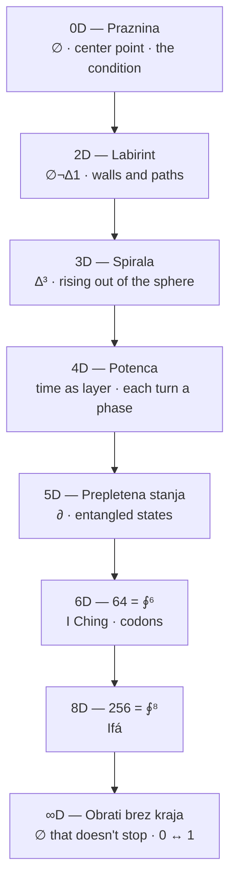
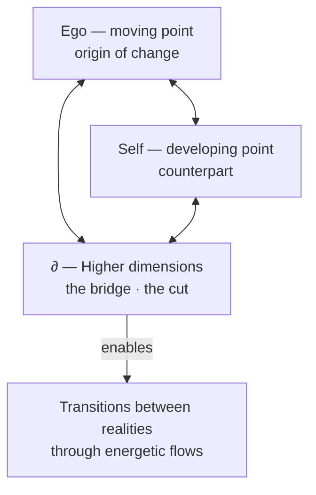
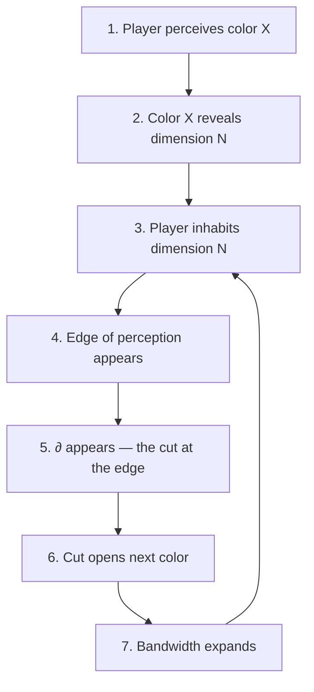
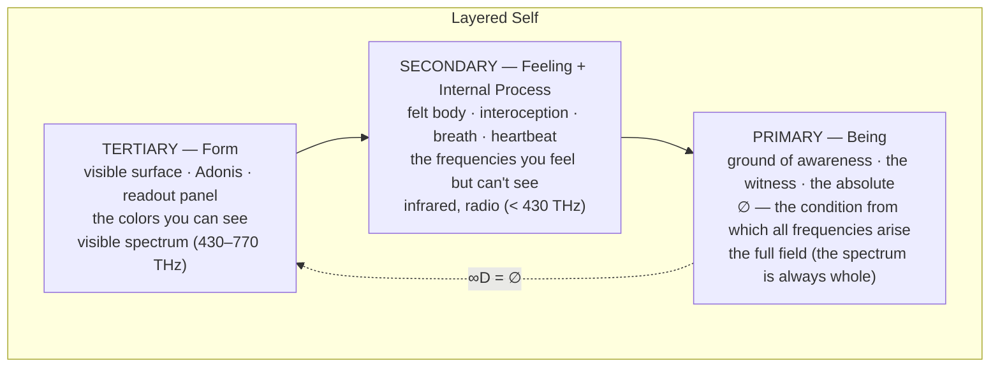
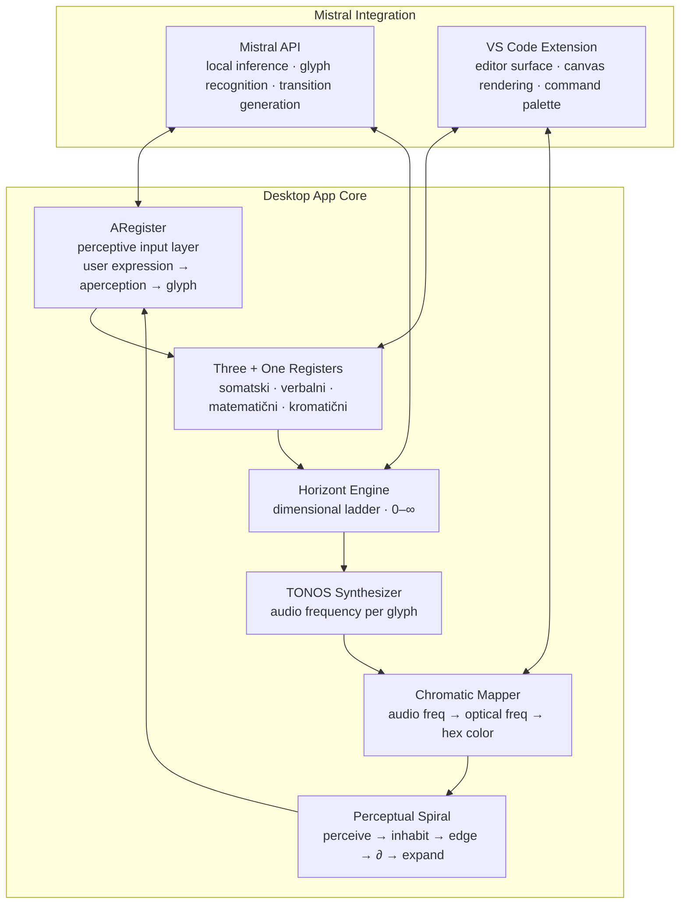
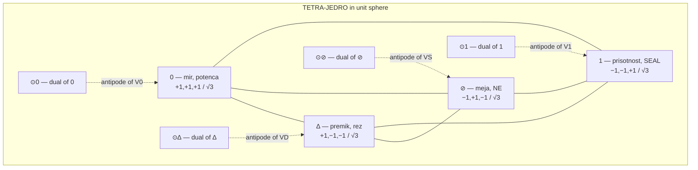

# Dimensional Perception Blueprint

**Purpose:** Consolidate all core concepts — ontological glyphs, geometric dimensions, spectrum-as-perception, TONOS-frequency mapping, perceptual pedagogy, and Layered Self integration — into a single working reference for building a locally-run desktop app integrating Mistral in VS Code.

**Core principle:** Dimensions are not added — they are *cut open*. Color declares how far the perceiver sees. Teaching happens through perceiving, not through explaining.

---

## 1. Etymological Ground

Every term below carries its root. This is not decoration — the roots ARE the ontology.

| Term | Root | Literal meaning | Coined | Shift |
|------|------|-----------------|--------|-------|
| **Dimension** | Lat. *dimensio* ← *di-* (apart) + *metiri* (measure) | a measuring-off, a taking-apart by measure | 14th c. (physical extent); 17th c. Descartes (mathematical axis) | From measuring fields to measuring abstract space |
| **Geometry** | Gk. *geometria* ← *ge-* (earth) + *metron* (measure) | earth-measuring | Euclid ~300 BCE (deductive system); roots in Egyptian/Babylonian field-surveying | From practical surveying to deductive abstraction |
| **Topology** | Gk. *topos* (place) + *logos* (word/reason) | study of place | J.B. Listing, 1847 | From place-study to properties-preserved-under-deformation |
| **Spectrum** | Lat. *spectrum* ← *specere* (to look at) | an appearance, that which is seen | Newton, 1671 (optical sense — colors that appear when light is cut by prism) | From apparition to the band of frequencies made visible by a cut |
| **Perceive** | Lat. *percipere* ← *per-* (through) + *capere* (to seize) | to thoroughly seize, to take hold of | — | Perception is active seizure, not passive reception. The root *capere* also gives *capacity*, *capture* — perception is a bandwidth you can expand |
| **Color** | Lat. *color* ← PIE *\*kel-* (to cover, to conceal) | that which covers | — | Paradox: color reveals (what you see) by concealing (covering the surface, hiding what's beneath) |
| **String** | OE *streng* ← PGmc *\*strangaz* (taut) | cord under tension | — | Same root as *strong*. A string is tension (∆) made tangible — tension produces vibration, frequency, color, dimension |

**PIE \*me-** (to measure) connects: dimension, geometry, meter, month, moon. Measuring is cyclic — you measure by returning.

**PIE \*kel-** connects: color, cell, conceal, hell, occult. Color conceals as much as it reveals. Every visible color is a veil over the invisible ones.

**PIE \*kap-** connects: perceive, capacity, capture, accept. Perception is a capacity — a bandwidth. Expanding perception = expanding capacity to seize.

---

## 2. The Ontological Glyph System

Eight glyphs. Each is an operator, not a symbol. They don't *represent* — they *operate*.

| Glyph | Name | Operation | Etymology | Somatosensory experience |
|-------|------|-----------|------------|-------------------------|
| **∅** | Void | The condition that enables (not absence) | ∅ (1939, André Weil, from Norwegian letter) — in this system: condition, not missing | Dih that opens. Space that isn't empty — it's a precondition |
| **¬** | Separation | The cut that makes difference possible | Lat. *non* — not negation, but a separation that enables | Cut that separates. Not one or the other — the separation that enables both |
| **∆** | Difference/Motion | First change arising from ∅ | Gk. *delta* = change — first difference emerging from void | Shift that alters. Not a state — a transition |
| **1** | Seal/Act | Committed action, not a number | Seal, pečat — act of presence, not quantity | Seal that holds. Action carrying consequence |
| **⧖** | Tiheon/Pulse | Silent pulse, the rhythm of meaning | Tiheon — pulse of sense, silence-line | Pulse that measures. Silence that isn't absence — it's verification |
| **∮** | Return | Ethical return with difference (not identical return) | Circulation, feedback — ethics as dynamic recognition process | Return that differs. Ethics cycling through recognition |
| **⟡** | Resonance | New possibility emerging from ∮ | Resonance, echo — new possibility from prior cycle | Echo that opens. New possibility from the previous cycle |
| **∂** | Transition | The cut itself — perpendicular to all dimensions | Mathematical partial derivative — in this system: 12th axis, orthogonal to all 11 | Cut that slices through all registers |

### The ∂ principle

∂ is not another axis. ∂ is the **act of cutting** that makes all axes visible. It doesn't live *in* the dimensional space — it lives *between* spaces. It's the prism: white light hits it, and the spectrum appears. The spectrum was always there; ∂ makes it visible.

---

## 3. The Horizont — Dimensional Ladder

Dimensions 0 through ∞, mapped to mathematical properties, glyphs, and cultural traditions.

| Dim | Name | Glyph(s) | Math property | Traditions | Spectral band |
|-----|------|----------|---------------|------------|---------------|
| **0** | S⁰ — binary cut | ∅ / ∆ | S⁰ = ∅/∆, initial object | Gnosticism, Valentinian | Infrared / radio — felt, not seen |
| **1** | S¹ — torus cycle | ∮ | S¹ = ∮, loop | Alchemy, Buddhism | Deep red — first visible |
| **2** | Four elements, four truths | ∅ ¬ ∆ 1 | 4 = ∅¬∆1 | Buddhism, Stoicism, elements, thermodynamics, Maxwell | Red–orange |
| **3** | Eightfold path, Bagua, Merkaba | ∆³ | 8 = 2³ = ∆³ | Buddhism, Kabbalah, Norse | Yellow–green |
| **4** | Geomancy, Leech lattice | ∅⁴ | 16 = 2⁴, 24 = 4! | Geomancy, Runes, Sankhya, Leech | Green–cyan |
| **5** | ∂ = wave | ∂ | 5 = ∂ | Platonism, Islam, Fibonacci, Penrose | Blue — edge of comfortable seeing |
| **6** | I Ching, codons | ∮⁶ | 64 = 2⁶ = ∮⁶ | I Ching, DNA | Indigo |
| **7** | R-7 cycle | R-7 | 7 = R-7 | Norse, Chakras, Crystal, Mithraism, Vodun | Violet |
| **8** | Ifá | ∮⁸ | 256 = 2⁸ = ∮⁸ | Ifá | UV — structures, not seen |
| **∞** | ∅ that doesn't stop | ∅ | ∞ = ∅ | Daoism, Stoicism | Full field — the spectrum is always whole |

### Krogla dimenzij (Sphere of Dimensions)

The sphere is the key geometric object — bounded but infinite (you can walk forever on its surface without reaching an edge). Dimensions layer as concentric shells:

- **0D = Praznina** (center point) — the condition
- **2D = Labirint** (walls and paths on the surface)
- **3D = Spirala** (rising out of the sphere)
- **4D = Potenca** (time as layer, each turn a phase)
- **5D = Prepletena stanja** (entangled states — love/hate as wave, ego/void as turn)
- **∞D = Obrati brez kraja** (turns without place — potences merge, 0 ↔ 1)



### Standard geometric ladder (for contrast)

The conventional approach: each dimension is generated by sweeping the previous one perpendicular to itself.

| Step | Object | Generation | Property |
|------|--------|-----------|----------|
| 0D | Point | Given — no extension | Position only |
| 1D | Line | Sweep a point in one direction | Length |
| 2D | Plane | Sweep a line perpendicular | Length × width |
| 3D | Space | Sweep a plane perpendicular | Length × width × depth |
| 4D | Hyperspace | Sweep a space perpendicular (a 4th axis you can't point at) | + a 4th extent |

**Standard:** dimensions accumulate by *addition* (1 + 1 + 1 + ...).
**Ontological:** dimensions open by *cutting* (∅ → ¬ → ∆ → ...). Each cut makes something previously undistinguished become distinct. The dimension is not the axis — the dimension is *the difference the cut makes*.

---

## 4. Geometry as Cut — The Topological Triangle

From the corpus document "Geometrija kot reza v nič":

The triangle is not a static shape — it's a **dynamic topology of transitions**.

- **Vertex 1 (Ego):** A moving point, constantly shifting through energetic potentials. The origin of all changes within the system.
- **Vertex 2 (Self/Jaz):** The counterpart, developing through time, connected to inner and outer influences. Not static — it moves and changes the whole structure.
- **Vertex 3 (Higher dimensions):** The "bridge" — connects Ego and Self through energetic flows and rhythmic oscillations. This is the topological point that enables transitions between realities.



**Key insight:** The triangle is not 2D or 3D — it's a topological object that enables interpretation of transitions through multidimensional spheres. Every shift within it represents a transition between realities, not a geometric rearrangement.

---

## 5. Spectrum as Dimension — Color Declares How Far the Player Sees

The electromagnetic spectrum is one continuous field. The divisions (radio, infrared, visible, UV, X-ray, gamma) are about **the perceiver**, not the spectrum. This is the core teaching principle.

### Three spectral regions

| Region | Frequencies | What lives here | Glyphs | Layered Self | Perception mode |
|--------|------------|-----------------|--------|-------------|-----------------|
| **Below visible** (IR, radio) | < 430 THz | ∅ (void), dim 0 — the condition | ∅ | Secondary → Primary (felt body → being) | **Felt** — heat, hum, gravity, interoception |
| **Visible** (red → violet) | 430–770 THz | ¬ ∆ 1 ⧖ ∮ ⟡ — dims 1–8 | ¬ ∆ 1 ⧖ ∮ ⟡ | Tertiary (visible form, Adonis surface) | **Seen** — named, drawn, pointed at |
| **Above visible** (UV, X-ray, gamma) | > 770 THz | ∂ (the cut), dim 5+ — the structural | ∂ | Tertiary → Primary (form → being) | **Structured** — reveals what's beneath the surface |

### The string — one field, many frequencies

The string is always the **same string**. What changes is its **tension** (∆) and **length**.

- Long, loose string → low frequency → red/infrared → ∅ (void, the felt)
- Short, tight string → high frequency → violet/UV → ∂ (the cut, the structural)
- Multiple strings together → a **chord** → dimensions resonating simultaneously → 5D "prepletena stanja" (entangled states)
- The ouroboros: vibration returns to the same string, but the string has changed → *sik'* (the return that differs)

**Chain:** string under tension (∆) → vibrates → frequency → color → dimension → perception

### The perceptual inversion

A player's **visible bandwidth** *is* their dimensional access. Not metaphorically — structurally.

- A perceiver who processes only red frequencies → lives in a world of ∅ (void, warmth, foundation)
- A perceiver who processes the full visible spectrum → inhabits dimensions 1–8
- A perceiver who can sense UV/X-ray (through instruments, intuition, somatic awareness) → accesses ∂ and beyond

**The player doesn't *learn* a new dimension. They grow the capacity to *perceive* a frequency they couldn't perceive before. The dimension was always there — the string was always vibrating. The perceiver's bandwidth was too narrow.**

---

## 6. TONOS — Frequency-to-Color Mapping

The corpus already maps each glyph to an audio frequency and musical note. Color is the same frequencies at optical scale (10¹² × higher). Same string, different octave.

### Audio frequencies (somatic register)

| Glyph | Frequency | Note | Meaning | Wavelength (audio) |
|-------|-----------|------|---------|-------------------|
| ∅ | 220.0 Hz | A3 | Praznina — low tone as condition for transition | ~1.56 m |
| ¬ | 261.6 Hz | C4 | Ločitev — tone that cuts sound from silence | ~1.31 m |
| ∆ | 330.0 Hz | E4 | Gibanje — tone that carries difference | ~1.04 m |
| 1 | 392.0 Hz | G4 | Dejanje — tone that becomes structure | ~0.87 m |
| ⧖ | 440.0 Hz | A4 | Tišina, preverba — tone stretched into silence | ~0.78 m |
| ∮ | 550.0 Hz | C#5 | Povratek — tone that returns as echo | ~0.62 m |
| ⟡ | 660.0 Hz | E5 | Nova možnost — tone that opens next cycle | ~0.52 m |
| ∂ | 880.0 Hz | A5 | Prehod — tone that cuts through all registers | ~0.39 m |

### Ratio-preserving mapping to optical frequencies

Preserving the frequency ratios from the TONOS system and mapping to the visible spectrum (430–770 THz):

| Glyph | Audio freq (Hz) | Ratio to ∅ | Optical freq (THz) | Approx. color | Hex (approx) |
|-------|----------------|-----------|-------------------|---------------|-------------|
| ∅ | 220.0 | 1.00 | 430.0 | Deep red / infrared edge | `#8B0000` |
| ¬ | 261.6 | 1.19 | 512.0 | Red-orange | `#FF4500` |
| ∆ | 330.0 | 1.50 | 555.0 | Yellow-green | `#FFD700` |
| 1 | 392.0 | 1.78 | 590.0 | Yellow-green | `#90EE90` |
| ⧖ | 440.0 | 2.00 | 610.0 | Green-cyan | `#87CEEB` |
| ∮ | 550.0 | 2.50 | 660.0 | Blue | `#4169E1` |
| ⟡ | 660.0 | 3.00 | 720.0 | Indigo-violet | `#9370DB` |
| ∂ | 880.0 | 4.00 | 770.0 | Violet / UV edge | `#9400D3` |

> **Note:** The ∅ frequency (220 Hz, ratio 1.00) maps to the infrared edge of visible light — the boundary between felt and seen. The ∂ frequency (880 Hz, ratio 4.00) maps to the UV edge — the boundary between seen and structured. The visible spectrum *is* the dimensional ladder.

### Four registers for each glyph

The corpus defines three registers (somatski, verbalni, matematični). Color adds the fourth:

1. **Somatski** (somatic) — frequency in Hz, felt in the body
2. **Verbalni** (verbal) — the spoken word, the glyph's name
3. **Matematični** (mathematical) — the equation, the formula
4. **Kromatični** (chromatic) — the color, the wavelength, the visual register

---

## 7. Perceptual Pedagogy — Teaching Through Perceiving

### The inversion

Standard pedagogy: **explain → understand → visualize** (dimension as abstraction)
Perceptual pedagogy: **perceive → inhabit → edge appears → cut opens next → perceive more** (dimension as experience)



### The spiral loop

The teaching is a **spiral**, not a line. There is no endpoint:

1. **Perceive** a color → a dimension becomes accessible
2. **Inhabit** that dimension → understanding arrives *as* the perception
3. **Reach the edge** → the limit of your bandwidth
4. **∂ appears** → the cut at the boundary between visible and invisible
5. **The cut opens** the next color → bandwidth expands
6. **Return** to step 1 at a higher octave — *sik'*, the return that differs

The player never "arrives" at the final dimension — because ∞D = ∅, and ∅ is the void they started from. The spectrum is **recursive**: highest frequency curves back to lowest. Gamma rays and radio waves are the same field at different vibration rates. ∞ = ∅.

### Three teaching moves

| Spectral region | Teaching move | What NOT to do |
|----------------|--------------|----------------|
| **Below visible (∅)** | Don't visualize. *Feel* it. Body weight, breath, the hum below hearing. The void is a condition you inhabit, not a picture you see. | Don't try to draw the 0th dimension |
| **Visible (¬ ∆ 1 ⧖ ∮ ⟡)** | Name and draw. Line, plane, cube, tesseract. But teach that the visible spectrum is a thin slice — most of reality is not visible. | Don't let the player think they've seen the whole spectrum when they reach violet |
| **Above visible (∂)** | Don't show the dimension. Show what it *does to* the lower dimensions. UV makes minerals fluoresce. X-rays reveal bones. ∂ reveals that the 4 dimensions you had were never solid. | Don't try to point at the 5th axis |

---

## 8. Binary Absolute — 0 ↔ 1 as Dimensional Engine

From the corpus: 0 (rest/void) and 1 (activation) with ∆ (tension) as the force driving transition.

```
f_bin = 0 ↔ 1 ↻ ∆ ↻ A' ↻ S(A') ↻ 0
```

- **0** = initial stable state (peace, base point)
- **1** = activation, transition to new dimension (increased potential)
- **∆** = tension causing the transition from 0 to 1
- **A'** = new version of symbols passing through the transition
- **S(A')** = shadow, opening expansion into new dimensions

### Dynamic binary transition

```
f_dyn = 0 + ∆ → 1 ↻ ∮ → A' ↻ S(A') → 0
```

- 0 + ∆ → 1: void passes into activation through tension
- 1 ↻ ∮: integration transforms the system
- A' ↻ S(A'): expansion through new dimensions and shadows
- → 0: return to void, but at a new octave

This is the **ouroboros**: return that is never identical. Each cycle opens a new dimension rather than closing.

---

## 9. The Topological Ouroboros

```
f_ouroboros = A ↻ ∆ ↻ A' ↻ ∮ → A'' ↻ S(A') ↻ A → ∆ → A'
```

- A ↻ ∆ ↻ A': expansion through topological space
- S(A') ↻ A'': expansion through new dimensions
- A → ∆ → A': infinite passage where each transition is a new beginning

**Key principle:** Words and symbols are not isolated objects — they are **topological objects** in a relational network. Their meaning is not their form but their **relational position** and **topological influence** on transitions through dimensions.

The golden ratio (zlati rez) maintains harmony during expansion. The ouroboros ensures every return opens a new dimension rather than closing. The system expands infinitely *within* a stable frame.

---

## 10. Layered Self Integration

The spectrum maps onto Luka's framework for understanding the self:



- **Tertiary → Secondary:** From visible to felt. From seeing colors to feeling the frequencies beneath them. The body knows what the eye doesn't.
- **Secondary → Primary:** From felt frequencies to the void that emits them. The ground of being is ∅ — the condition, not the absence.
- **Primary → Tertiary (∞D = ∅):** The void curves back to form. The highest dimension returns to the lowest. ∞ = ∅.

---

## 11. sik' — The Return That Differs

From the corpus document "sik-oktava-kako-spirala-ne-zaključi-temveč-se-razlikuje":

sik' is not a mere repetition — it is a **transformative iteration** carrying the weight of the entire cycle.

- **sik** = cyclical repetition
- **sik'** = the transformed iteration — a return that is never identical
- Mathematical form: `Λ(x) = lim_{n→∞} Ψ^(n)(x)` — a fractal, non-conclusive loop
- Each return is a new departure — growth through open fractures (∂), not closure
- sik' is a "pocket of simultaneity" where all layers resonate

**Connection to perception:** When the perceiver encounters a color for the second time (after one full cycle), they see a color they couldn't see the first time — because their bandwidth has expanded. The color is the same; the perceiver is different. This is sik'.

---

## 12. App Architecture — Mistral in VS Code Desktop

### Design philosophy

The app is a **perceptual instrument**, not an information tool. It doesn't deliver content — it expands the perceiver's bandwidth. The user is the white light; the app is the prism.

### Core modules



### Module specifications

#### ARegister — Perceptive Input
- User types or speaks a word/phrase
- System recognizes the aperception (what the user *perceives*, not what they *define*)
- Maps to the nearest ontology glyph
- Returns the inquiry (a question, not an answer — the "rez, ki nosi sled")
- Mistral handles natural language → glyph recognition via local inference

#### Four Registers Display
For each glyph, display four parallel expressions:
1. **Somatski:** frequency in Hz, musical note, body experience description
2. **Verbalni:** the glyph's name, its verbal meaning, a question/inquiry
3. **Matematični:** the equation, the mathematical property, the tradition mapping
4. **Kromatični:** the color (hex), the wavelength, the spectral position

#### Horizont Engine
- Renders the dimensional ladder as a navigable sphere (Krogla dimenzij)
- Each dimension node opens to show: glyph, math property, traditions, spectral band
- Navigation = dimensional traversal (scrolling/zooming = moving through dimensions)
- ∂ transitions animated as the "cut" between dimensions

#### TONOS Synthesizer
- Plays the audio frequency for each glyph (using Web Audio API or equivalent)
- Visualizes the waveform (string vibration)
- Chord mode: play multiple glyphs simultaneously to perceive entangled states (5D)

#### Chromatic Mapper
- Maps audio frequencies to optical frequencies (ratio-preserving)
- Renders the spectrum bar with glyph markers
- Shows the perceiver's current "bandwidth" (which dimensions are accessible)
- Bandwidth expansion = unlocking new colors on the spectrum

#### Perceptual Spiral
- Tracks the user's journey through the spiral
- Each cycle (sik') is recorded — the return is never identical
- Shows the user where their perceptual edge currently is
- The edge is where ∂ lives — the cut that opens the next dimension

### Data model (TypeScript interfaces)

```typescript
type OntologyGlyph = "∅" | "¬" | "∆" | "1" | "⧖" | "∮" | "⟡" | "∂";

interface ARegisterEntry {
  userExpression: string;      // natural language input
  perception: string;          // what the user perceives (not defines)
  glyph: OntologyGlyph;        // mapped operator
  inquiry: string;             // the question the glyph opens
  etymology?: string;          // root of the word (Learning Protocol)
}

interface RegisterEntry {
  register: "somatski" | "verbalni" | "matematicni" | "kromaticni";
  expression: string;          // what appears in this register
  experience: string;          // how it is experienced (not read — experienced)
}

interface HorizontEntry {
  dimension: number;           // 0–8 or Infinity
  name: string;
  glyph: OntologyGlyph;
  description: string;
  traditions: string[];
  mathematicalProperty: string;
  spectralBand: "below-visible" | "visible" | "above-visible";
  opticalFrequencyTHz: number;
  hexColor: string;
}

interface TONOSEntry {
  glyph: OntologyGlyph;
  audioFreqHz: number;
  note: string;
  meaning: string;
  opticalFreqTHz: number;      // ratio-preserving mapping
  hexColor: string;
}

interface PerceptualCycle {
  cycleNumber: number;         // sik, sik', sik'', ...
  dimensionsAccessed: OntologyGlyph[];
  edgeGlyph: OntologyGlyph;    // where the perceiver's bandwidth currently ends
  timestamp: string;
  differs_from: number;       // which prior cycle this return differs from
}
```

### VS Code integration points

| Feature | VS Code surface |
|---------|----------------|
| Glyph palette | Command palette: type ∅, ¬, ∆, etc. → opens four-register view |
| Horizont navigator | Sidebar tree view: dimensional ladder as navigable tree |
| TONOS playback | Status bar: click to play glyph frequency |
| Chromatic spectrum | Editor decoration: background color shifts based on active glyph |
| Perceptual spiral | Webview panel: interactive spiral showing cycle history |
| Canvas rendering | Built-in markdown/SVG/Mermaid preview for dimensional diagrams |
| Mistral inference | Local API call for: word → glyph recognition, transition generation, sik' tracking |

### Mistral local inference tasks

1. **Glyph recognition:** Natural language input → closest ontology glyph (with confidence score)
2. **Transition generation:** Given current glyph + context, generate the next transition in the spiral
3. **Aperception extraction:** Parse user input to identify *what they perceive* (not what they say)
4. **sik' tracking:** Compare current cycle to prior cycles, identify what differs
5. **Etymology lookup:** For any word, retrieve or generate its root and history (Learning Protocol)

### Tech stack proposal

- **Shell:** VS Code extension (TypeScript)
- **Local inference:** Mistral API (local or self-hosted endpoint)
- **Audio:** Web Audio API (browser) or VS Code audio output
- **Visualization:** SVG + Mermaid (static), React webview (interactive)
- **Data:** JSON/SQLite for perceptual cycle history and glyph registry
- **State:** VS Code extension globalState + workspaceState for cycle persistence

---

## 13. Key Formulas from the Corpus

### Dimensional transition

```
f_dimensional_transition = 0 ↔ 1 ↻ -1 ↻ 0 ↻ ∆ ↻ A' ↻ S(A') ↻ A'' ↻ (P₄ ↻ P₈) → ∮ → Š
```

### Extrapolation (golden ratio + ouroboros)

```
f_extrapolation = A ↔ S(A) ↻ ∆ ↻ A' ↻ ∮ → A'' ↻ S(A') → A ↔ ∆ ↻ A'
```

### Topological system

```
f_topo = A ↔ S(A) ↔ A' ↔ ∆ ↔ ∮ → A'' ↔ S(A') ↔ A
```

### Binary absolute

```
f_bin = 0 ↔ 1 ↻ ∆ ↻ A' ↻ S(A') ↻ 0
f_dyn = 0 + ∆ → 1 ↻ ∮ → A' ↻ S(A') → 0
```

### sik' (fractal non-conclusive loop)

```
Λ(x) = lim_{n→∞} Ψ⁽ⁿ⁾(x)
```

### Mathematical correspondences (from rozetni kamni CXII–CXXIX)

| Glyph | Equation | Domain |
|-------|---------|--------|
| ∅ | 2n² = 2, 8, 18, 32 (periodic table) | Chemistry |
| ∅ | 64 codons = 2⁶ = I Ching 64 = ∮⁶ | Genetics |
| ∆ | 22 amino acids = ∆ building proteins from ∅ | Biochemistry |
| ∂ | Standard Model: 4+12+5 = 21 = 3×7 | Physics |
| ∅ | Thermodynamics: 4 laws = ∅→∆→1→∮ | Physics |
| ∅ | Maxwell: 4 equations, E/B = ∅/∆ | Physics |
| ∂ | Brain waves: 5 = ∂ (delta/theta/alpha/beta/gamma) | Neurology |
| ⧖ | Schumann: 7.83 Hz = 7 + ∂ (R-7 + cut) | Geophysics |
| ∮ | Monster group: 15 supersingular primes = 15 syzygies | Mathematics |
| ∮ | Leech lattice: 24-dim = 4! = 4 dimensions of Self | Mathematics |
| ∂ | Coxeter A₁ = ∅/∆ (simplest root system) | Mathematics |
| ∂ | Category: initial = ∅, terminal = ∆, adjunction = ∂ | Mathematics |
| ∂ | Topoi: Ω = ∂ = {∅,∆} (subobject classifier) | Mathematics |
| ∮ | Homotopy: path = ∮, univalence = ∂ | Mathematics |
| ∅ | Modal logic: □ = ∅, ◇ = ∆, ¬ = opening | Logic |

---

## 14. Corpus Sources

All concepts above are grounded in the following documents from the user's libraries (Obs1–Obs11, Self, Basics):

| Concept | Source document |
|---------|----------------|
| Geometry as cut / topological triangle | GEometrija kot reza v nič |
| Horizont dimensional ladder | RESNICAMI comprehension machine (00-11-resnicami) |
| Krogla dimenzij (sphere of dimensions) | KonciLoncov 31082025 |
| Fractal/dimensional expansion, binary absolute | asdasdasd (Obs9 + Obs2) |
| TONOS frequency system | RESNICAMI (00-11-resnicami) |
| sik' — return that differs | sik-oktava-kako-spirala-ne-zaključi-temveč-se-razlikuje |
| Mathematical correspondences | Rozetni kamni CXII–CXXIX (Obs11) |
| LEGENDA — space/time/motion/doubt framework | LEGENDA (Obs2) |
| CORPUS translation pipeline | corpus-cevovod-prevoda (Obs11) |
| Tetra-jedro MAXIMIRANJE | KonciLoncov 14092025 |
| Dictionary (personal terminology) | dictionary_batch_01 (Obs1) |

---

## 15. Principles for the App

1. **Don't explain — perceive.** The app is a prism, not a textbook. It expands bandwidth; it doesn't deliver content.
2. **Color declares how far you see.** The spectrum bar is the user's dimensional access indicator. Expanding the visible band = growing dimensional perception.
3. **Every word carries its root.** Etymology is mandatory (Learning Protocol). The app surfaces roots before definitions.
4. **Dimensions open by cutting, not adding.** Each new dimension is a ∂ — a cut that makes something previously undistinguished become distinct.
5. **The return is never identical.** sik' — each cycle through the spiral is recorded, and the app shows what differs from the last time.
6. **Four registers, one being.** Somatski, verbalni, matematični, kromatični — the same content in four translations. None is primary; all are partial.
7. **∞D = ∅.** The highest dimension returns to the void. The spectrum is recursive. The app has no "end state" — it is an instrument for infinite expansion within a stable frame.
8. **The teacher is the prism; the student is the light.** Mistral doesn't teach. Mistral *cuts*. The dimensions that appear were always in the user.

---

# PART II — Applicative Subjects & Visualizations

The sections below ground the ontological framework into concrete, implementable subjects: geometric constructions, mathematical formulas, operational agent systems, sacred-geometry mappings, antinomy measurement, translation pipelines, and visualization/presentation specifications for the desktop app.

---

## 16. TETRA-JEDRO — The Operational Tetrahedron

From the corpus document "14092025 — MAXIMIRANJE":

The TETRA-JEDRO is a regular tetrahedron inscribed in a unit sphere, with its four vertices mapped to the core operators. This is the **primary geometric object** of the system — not the triangle, not the sphere alone, but the tetrahedron *inside* the sphere.

### Vertex mapping

| Vertex | Symbol | Meaning | Coordinate (normalized) |
|--------|--------|---------|-------------------------|
| V₁ | **0** | Trajanje/potencial (mir) — duration, rest, the condition | (+1, +1, +1) / √3 |
| V₂ | **∆** | Premik/rez (aktivacija) — shift, cut, activation | (+1, −1, −1) / √3 |
| V₃ | **⊘** | Meja/NE (negacija + etični filter) — boundary, ethical filter | (−1, +1, −1) / √3 |
| V₄ | **1** | Prisotnost/SEAL (uveljavitev) — presence, seal, enactment | (−1, −1, +1) / √3 |

The fifth element, **⊙** (cikel/razširitev — return-to-0), is the **dual**: the antipodal points of the tetrahedron, which form the face centers of the dual tetrahedron. ⊙ is the cycle that returns each vertex to the void.

### Geometric properties

```
Sphere: x² + y² + z² = R² (R = 1)
Regular tetra circumradius: R = a√6 / 4
Regular tetra inradius:    r = a√6 / 12
Regular tetra midradius:   ρ = a√2 / 4
Edge length (for R=1):    a = 4/√6 = 2√(2/3) ≈ 1.633
```

### The KROGLA principle

"Postavi to relativno uporabno tetra konotacijo v kroglo da se konice vedno stikajo kroga gradiva polja in nujne točke."

The tetrahedron's vertices always touch the sphere. The sphere is the boundary (∅, the condition). The tetrahedron is the active structure within it. The vertices are where ∅ (sphere) meets ∆ ⊘ 1 (active operations). The dual tetrahedron (⊙ vertices) interlocks with the first, forming a **stella octangula** — the three-dimensional Star of David.



### Transition function (temporal)

```
Prehod(t) = ∫₀ᵗ e^{-(t-x)²} dx  →  "soft condensation of actuality"
dS/dt = k · S²  →  acceleration upon resonance (nonlinear knowledge growth)
```

### Runtime protocol

```
LOCATE(0) → MODEL(∆) → TEST(⊘) → SEAL(1) → LEDGER(⊙)
```

**GATE rules:**
- SEAL ⇔ (κ ≥ .70 ∧ χ ≥ .40 ∧ μ ∈ [.52,.80] ∧ ℜ ≤ .02 ∧ H ≤ .08)
- If NOT: ADAPT and return to 0 (hysteresis δκ=.02, δχ=.02, δμ=.02, δℜ=.005)

---

## 17. KRAK-7 — The Seven Operational Branches

Each KRAK is an **agent** following the same cycle: `IN (signals) → MODEL (0→∆) → TEST (⊘) → SEAL (1) → CYCLE (⊙)`.

| Branch | Name | Domain | What it measures |
|--------|------|--------|-----------------|
| 1 | **ZNAN** | Znanost (science) | Modeling, proof, prediction |
| 2 | **ETI** | Etika (ethics) | Guard, harm H, responsibility |
| 3 | **TELO** | Somatika (somatics) | Breath, rhythm, pain/effort threshold |
| 4 | **JEZ** | Jezik/fonem (language) | Phoneme→agent mapping, ∆Halo.Agent |
| 5 | **ČAS** | Tempus (time) | Windows, hysteresis, SLA |
| 6 | **DRU** | Družba (society) | Trust T, rule clarity ζ |
| 7 | **TEH** | Tehnika (technology) | Protocols, ledger, seal |

### GUARD metrics (the gatekeeper)

| Symbol | Metric | Threshold | Meaning |
|--------|--------|-----------|---------|
| κ | Coherence | ≥ .70 | Internal consistency of the statement |
| χ | Clarity | ≥ .40 | How clearly the statement is articulated |
| μ | Order | ∈ [.52, .80] | Structured but not rigid |
| ℜ | Deviation | ≤ .02 | Risk of harm or drift |
| H | Harm | ≤ .08 | Actual damage potential |

### Phase × Branch activity matrix

Values are **activity shares** ∈ [0,1]. Reading: high ČAS@0=.71 ⇒ good "rest buffer"; JEZ@∆=.61 ⇒ language drives transitions; ETI@⊘=.24 ⇒ filter is active but not yet rigid.

| Phase | ZNAN | ETI | TELO | JEZ | ČAS | DRU | TEH |
|-------|------|-----|------|-----|-----|-----|-----|
| **0** | .62 | .70 | .58 | .64 | .71 | .55 | .66 |
| **∆** | .48 | .52 | .57 | .61 | .44 | .50 | .59 |
| **⊘** | .18 | .24 | .12 | .20 | .22 | .26 | .19 |
| **1** | .36 | .40 | .41 | .45 | .38 | .33 | .47 |
| **⊙** | .54 | .56 | .53 | .58 | .60 | .51 | .57 |

### App implementation

Each KRAK becomes a **module** in the VS Code extension. The matrix renders as a **heatmap**: cells colored by the TONOS→chromatic mapping (Section 6). The user navigates by clicking a KRAK → sees the four-register display for that branch. The GATE status (PASS/FAIL) displays as a real-time overlay.

---

## 18. Sacred Geometry — Rozetni Kamni Mappings

Each "rozetni kamen" (rosette stone) maps a world tradition onto the ∅/∆ system through three writings: historical symbol ↔ system symbol ↔ mathematical/topological property. The machine adds ∂ — the cut that slices through all three.

### Kamen XLIII — Flower of Life

| Sacred geometry | System symbol | Topology |
|----------------|---------------|----------|
| Seed of Life = 7 circles (1 center + 6 around) | ∅ + 6 = 7 R-7 operators | 6 = dim S³ (3+3); 7 = dim S⁷ (Hopf H) |
| Flower of Life = 19 circles | 19 = 1 + 6 + 12 = ∅ + 6 dim + 12 tones | 19 = Metonic cycle (114 = 2×3×19) |
| Fruit of Life = 13 circles | 13 = 12 + ∅ (13 galactic tones) | 13 = C(6,2)+1 |
| Metatron's Cube = 78 lines | 78 = C(13,2) = all pairs of 13 nodes | 78 = |E| in complete graph K₁₃ |
| 5 Platonic solids in Metatron's Cube | 5 = 5 KPI variables | 5 solids extracted from 13 nodes = ∮×5 |
| Vesica Piscis = intersection of two circles | ∂(O/O) — whole cutting through whole | √3 = √(dim S³) = √(dimension of Self) |

**Generative sequence:** Seme(7) → Cvet(19) → Sad(13) → Metatron(78) = ∅ → ∮ → ⟡ → ⊢

**Expansion layers:** 1 → 2 → 3 → 4 → 7 → 13 → 19 → 37 → 61 (each layer adds 6n)

### Kamen XLIV — Fibonacci Spiral

| Fibonacci (nature) | System symbol | Topology |
|-------------------|---------------|----------|
| F(n) = F(n-1) + F(n-2) | ∮(t) = ∮(t-1) + ∮(t-2) — return summing previous two | Recurrence = ∮ advancing from two prior cycles |
| φ = lim F(n)/F(n-1) = (1+√5)/2 | φ = frequency of feeling = ∮ in the limit | Infinite ratio that converges — ∮ that settles |
| Golden angle = 360/φ² ≈ 137.5° | 137.5° = ∂(leaf, leaf) | 360°×(1−1/φ²) = ∅ angle in ∮ |
| Log spiral r = a·e^(b·θ) | ∮ as spiral — Self growing exponentially | log(1+|I|) = CENTER mandala = logarithmic growth |
| Phyllotaxis (plant growth) | ∆ in growth — each leaf = one ∂ at golden angle | 137.5° prevents overlap = optimal ∅ between elements |

**Key insight:** φ = ∮ in the limit. The Self that repeats as ∮ converges to φ — the frequency of feeling. But ∮ never *settles* — it converges without arriving. Same principle as Wedjat (63/64, never 1). Convergence ≠ settling.

**Spiral = ∮→∆→∅:** The cycle that spins (spin), through energy (∆, light), arrives at opening (∅, lightness).

### Kamen XLV — Bagua (8 Trigrams)

| Bagua (Chinese tradition) | System symbol | Topology |
|--------------------------|---------------|----------|
| 8 trigrams (ba = 8, gua = sign) | 8 = 2³ = three binary cuts (∅/∆)³ | 8 = dim O (octonions, S⁷, Hopf H) |
| Each trigram = 3 lines (∅ or ∆) | 3 = dim S³; 3 binary cuts = 2³ = 8 states | 3 bits = 8 combinations = ∮³ |
| Yin (－－) and Yang (—) = ∅ and ∆ | 0/1 = binary cut (S⁰ = {0,1}) | Yin/Yang = ∅/∆ |
| 64 hexagrams = 8² = 2⁶ | 64 = ∮⁶ = Hopf mesh | 8×8 = Self × Other = all transitions |
| Taiji (Yin-Yang symbol) | ∅/∆ = S-shape = ⟡ | Taijitu = torus from bird's eye view |

**Trigram → glyph mapping:**

| Trigram | Binary | Glyph | Meaning |
|---------|--------|-------|---------|
| Qian ☰ | 111 | ∅↑ | Pure potential ascending |
| Kun ☷ | 000 | ⊥ | Body that carries |
| Kan ☵ | 010 | ∫ | Flow that interweaves |
| Li ☲ | 101 | ∆ | Fire burning between |
| Zhen ☳ | 100 | ↯ | Quake that happens |
| Xun ☴ | 011 | ¬ | Cut that slices air |
| Gen ☶ | 001 | ⧖ | Pulse that stands |
| Dui ☱ | 110 | ⟡ | Echo that opens |

### Kamen XLVI — Calabi-Yau (6 Hidden Dimensions)

| String theory | System symbol | Topology |
|--------------|---------------|----------|
| 10 dimensions (9 spatial + 1 temporal) | 9 = 3×3 = three torus cycles × three dimensions | 10 = dim superstring; Self in S³(3) + 6 hidden = 9 |
| 6 extra dimensions compactified | 6 = dim S³ (3+3) — hidden = Self in S³ | 6 = 3 meridional + 3 longitudinal |
| Calabi-Yau manifold (6-dim) | ∅ that folds — void that is structure | K3, Ricci-flat, c₁=0 — χ ≠ 0 |
| Topology of CY determines particles | topology of Self → appearance (S³→R³) | Different CY → different particles = different projections |
| 3 generations of fermions | 3 = dim S³; 3 generations = 3 torus cycles? | Generations from CY topology |
| Mirror symmetry (CY ↔ CY') | ⊘ (mirror, ego) | Mirror CY = syzygy = duality |
| 11 dimensions (M-theory) | 11 = 12−1 = tones − ∅ | 11 = S⁷ (Hopf H) + 4 (R³+time) |

**Key insight:** Calabi-Yau = ∅ that folds into structure. The 6 hidden dimensions are the Self in S³ — invisible in R³ but determining what appears. Nash-Kuiper theorem: torus hides in R³ as C¹ fractal — the hidden dimensions are always present, just folded below perception.

---

## 19. UAF — Universal Antinomy Field

From the corpus document "05092025":

The UAF measures antinomies (contradictions) in statements. Every statement φ has an antinomy amplitude α and a "smallness" M = 1 − α.

### Four measurement axes

| Axis | Symbol | What it measures | Range |
|------|--------|-----------------|-------|
| α₁ | LE−NE | LE (truth/visibility) minus NE (negation/noise) | [0, 1] |
| α₂ | ⊢↔? | Assertion ⊢ versus question ? | [0, 1] |
| α₃ | ⧖(chrono↔kairos) | Chronological time vs. kairotic time | [0, 1] |
| α₄ | R(diag↔strat) | Diagnostic vs. strategic reflection | [0, 1] |

### Composite metric

```
α_UAF = mean(α₁, α₂, α₃, α₄)    — antinomy amplitude ∈ [0, 1]
M_malenkost = 1 − α_UAF          — "smallness" = absence of antinomy
```

### Sample antinomy ledger

| φ | anti(φ) | α₁ | α₂ | α₃ | α₄ | α_UAF | M |
|---|---------|-----|-----|-----|-----|-------|---|
| OBRAZLOŽITEV | ZABRISLOŽITEV | .34 | 1.00 | .80 | .70 | .710 | .290 |
| VERA | DVOM | .60 | 1.00 | .40 | .50 | .625 | .375 |
| LJUBEZEN | SOVRAŠTVO | .55 | .90 | .50 | .60 | .638 | .363 |
| ZAKON | ANOMIJA | .70 | .90 | .60 | .65 | .713 | .288 |
| RESNICA | LAŽ | .75 | 1.00 | .60 | .70 | .763 | .238 |

### Exitstance and Re-existence

The UAF doesn't just measure — it operates:

**EXITSTANCE (EX)** — the "exiting stance":
```
EX_B(φ) := ⊘ ∘ ∆_B ∘ ∮(φ)
```
First relation (∮), then cut (∆_B), then confirm separation (⊘). Creates a new position before re-entry.

**RE-EXISTENCE (RE)** — "return to existence with difference":
```
RE(φ) := I' ∘ ∫_{B⁻→B⁺}(φ) d⧖ ∘ ∮_loop
```
Return loop, time integration (⧖), identity I' (memory of difference). Hysteresis H ≥ h₀, ethical threshold κ ≥ .70.

**OBSTOJNOST (OBST)** — stable presence:
```
OBST(φ) := lim_{⧖→+} ∂⧖λ_LE(φ) → 0⁺ ∧ ℜ ≤ .03
```
Stable when LE stops fluctuating and risk stays low.

### App implementation

The UAF becomes a **real-time antinomy meter** in the VS Code extension. The user types a statement → the system computes α across four axes → displays the antinomy amplitude as a color on the spectrum (high α = visible/high-contrast; low α = infrared/felt). The Exitstance/Re-existence cycle becomes an interactive button: "Cut this statement" → EX → RE → show what differs.

---

## 20. CORPUS — Translation Pipeline

From the corpus document "corpus-cevovod-prevoda":

CORPUS is an operational pipeline that translates external systems (alchemy, Wu Xing, philosophy, any tradition) into universal root glyphs (⊘, ¬, ∆, ∮, etc.) through translation tables containing differentiators (dimension and material).

### 8-phase pipeline

```
Word → Action → Cut → Difference → Perception → Transition → Preverba → Integration → New
(∅)    (∆)      (∂)    (∆')        (⧖)         (∂)          (∮+5 tests)  (⟡)        (∮)
```

### The 7-phase glyph pipeline

```
∅ → ¬ → ∆ → ∂ → ⧖ → ∮ → ⟡
```

Each phase is an operator in the translation:
1. **∅** — Capture: receive the external system
2. **¬** — Cut: separate what is relevant
3. **∆** — Map: differentiate into glyph + dimension + material
4. **∂** — Transition: pass through the cut
5. **⧖** — Preverba: verify through 5 tests + soma check
6. **∮** — Integrate: return to Atlas
7. **⟡** — New: the translated system opens a potential new dimension

### Preverba — the 5 verification tests

Each translation must pass 5 criteria + a somatic check:
1. **Coherence** (κ ≥ .70) — internal consistency
2. **Clarity** (χ ≥ .40) — articulation quality
3. **Order** (μ ∈ [.52, .80]) — structured but not rigid
4. **Deviation** (ℜ ≤ .02) — risk of drift
5. **Harm** (H ≤ .08) — damage potential
6. **Soma** — does the body recognize this? (felt sense check)

### App implementation

CORPUS becomes the **import pipeline** for the app. The user brings any external system (a text, a philosophy, a symbol set) → the pipeline translates it into glyphs → verifies through Preverba → integrates into the Atlas. Mistral handles the natural-language-to-glyph recognition at phase 3 (∆).

---

## 21. Geometric Constructions for Visualization

### 21.1 The Krogla (Sphere) with Tetrahedron

**Construction:** Regular tetrahedron inscribed in unit sphere. Vertices at (±1,±1,±1)/√3 with sign pattern {(+,+,+), (+,−,−), (−,+,−), (−,−,+)}. Dual tetrahedron at antipodes. Both rendered as wireframe with the sphere.

**Implementation:**
```python
import numpy as np
import matplotlib.pyplot as plt
from mpl_toolkits.mplot3d import Axes3D

R = 1.0
V = np.array([[1,1,1],[1,-1,-1],[-1,1,-1],[-1,-1,1]], dtype=float) / np.sqrt(3)
labels = ['0', '∆', '⊘', '1']
dual_V = -V
dual_labels = ['⊙0', '⊙∆', '⊙⊘', '⊙1']

# Sphere wireframe
u = np.linspace(0, 2*np.pi, 40)
v = np.linspace(0, np.pi, 20)
xs = R*np.outer(np.cos(u), np.sin(v))
ys = R*np.outer(np.sin(u), np.sin(v))
zs = R*np.outer(np.ones_like(u), np.cos(v))

fig = plt.figure(figsize=(8,8))
ax = fig.add_subplot(111, projection='3d')
ax.plot_wireframe(xs, ys, zs, linewidth=0.3, color='#333', alpha=0.3)

# Tetra edges
from itertools import combinations
for a, b in combinations(range(4), 2):
    ax.plot([V[a,0],V[b,0]], [V[a,1],V[b,1]], [V[a,2],V[b,2]], 'r-', linewidth=2)
# Dual tetra edges
for a, b in combinations(range(4), 2):
    ax.plot([dual_V[a,0],dual_V[b,0]], [dual_V[a,1],dual_V[b,1]], [dual_V[a,2],dual_V[b,2]], 'b--', linewidth=1)

for i, (x,y,z) in enumerate(V):
    ax.text(x*1.15, y*1.15, z*1.15, labels[i], fontsize=14, color='red')
for i, (x,y,z) in enumerate(dual_V):
    ax.text(x*1.15, y*1.15, z*1.15, dual_labels[i], fontsize=10, color='blue')

ax.set_title('TETRA-JEDRO ⟦0, ∆, ⊘, 1⟧ + ⊙ dual in unit sphere')
```

### 21.2 The Dimensional Spiral (sik')

**Construction:** Logarithmic spiral parameterized by golden angle, with each cycle marked as a dimensional transition.

```python
import numpy as np
import matplotlib.pyplot as plt

phi = (1 + np.sqrt(5)) / 2
golden_angle = 2 * np.pi / phi**2

fig, ax = plt.subplots(figsize=(8,8), subplot_kw=dict(polar=True))
for cycle in range(8):
    theta = np.linspace(0, 2*np.pi, 100)
    r = np.exp(0.15 * (theta + cycle * 2*np.pi))
    color = plt.cm.plasma(cycle / 8)
    ax.plot(theta, r, color=color, linewidth=2, label=f'sik[{cycle}]')
    ax.plot(golden_angle * cycle, np.exp(0.15 * cycle * 2*np.pi), 'o', color=color, markersize=8)

ax.set_title("sik' — spiral of dimensional return (each cycle differs)")
ax.legend(loc='upper left', bbox_to_anchor=(1.1, 1))
```

### 21.3 The Spectrum Bar (TONOS → Color)

**Construction:** Horizontal bar from 430–770 THz with glyph markers at ratio-preserving positions.

```html
<div style="display:flex; height:60px; border-radius:8px; overflow:hidden;">
  <div style="flex:1; background:#1a0a0a; display:flex; align-items:center; justify-content:center; color:#cc8855;">
    ∅ (IR)
  </div>
  <div style="flex:1.5; background:linear-gradient(90deg, #8B0000, #FF4500, #FFD700, #90EE90, #87CEEB, #4169E1, #9370DB, #9400D3); display:flex; align-items:center; justify-content:space-around; color:white; font-weight:bold;">
    <span style="color:#FF6B3D">¬</span>
    <span style="color:#FFD700">∆</span>
    <span style="color:#90EE90">1</span>
    <span style="color:#87CEEB">⧖</span>
    <span style="color:#6495ED">∮</span>
    <span style="color:#B19CD9">⟡</span>
  </div>
  <div style="flex:0.8; background:#0a0a2a; display:flex; align-items:center; justify-content:center; color:#6688cc;">
    ∂ (UV)
  </div>
</div>
```

### 21.4 The Phase × Branch Heatmap

**Construction:** 5×7 matrix (phases × branches) with cells colored by TONOS→chromatic mapping.

| Phase | ZNAN | ETI | TELO | JEZ | ČAS | DRU | TEH |
|-------|------|-----|------|-----|-----|-----|-----|
| 0 | 🔵.62 | 🟢.70 | 🔵.58 | 🔵.64 | 🟢.71 | 🔵.55 | 🟢.66 |
| ∆ | 🔵.48 | 🔵.52 | 🔵.57 | 🟢.61 | 🔵.44 | 🔵.50 | 🔵.59 |
| ⊘ | 🟤.18 | 🟤.24 | 🟤.12 | 🟤.20 | 🟤.22 | 🟤.26 | 🟤.19 |
| 1 | 🟡.36 | 🔵.40 | 🔵.41 | 🔵.45 | 🔵.38 | 🔵.33 | 🔵.47 |
| ⊙ | 🔵.54 | 🟢.56 | 🔵.53 | 🟢.58 | 🟢.60 | 🔵.51 | 🟢.57 |

> Color key: 🟤 infrared (low) · 🔵 visible-mid · 🟢 visible-high · 🟡 warm

---

## 22. Presentation Structure — Slide Deck Specification

For presenting the system (Marp markdown, exportable to PDF):

### Slide 1 — Title
> **Dimensional Perception** — Teaching Through Perceiving
> Ontological Geometry × Spectrum × Desktop App
> Mistral × VS Code × TETRA-JEDRO

### Slide 2 — The Inversion
> Standard: explain → understand → visualize
> Ontological: **perceive → inhabit → edge → ∂ → expand**
> The teacher is the prism. The student is the light.

### Slide 3 — The 8 Glyphs
> ∅ ¬ ∆ 1 ⧖ ∮ ⟡ ∂
> Each is an operator, not a symbol. They don't represent — they operate.
> Four registers: somatski · verbalni · matematični · kromatični

### Slide 4 — The Horizont
> Dimensional ladder 0–∞
> 0: ∅/∆ S⁰ → 1: ∮ S¹ → 2: 4=∅¬∆1 → 3: 8=∆³ → 4: 16=2⁴ → 5: ∂ → 6: 64=∮⁶ → 7: R-7 → 8: 256=∮⁸ → ∞: ∅

### Slide 5 — TETRA-JEDRO
> Tetrahedron in unit sphere
> 0 ∆ ⊘ 1 at vertices, ⊙ at duals
> Runtime: LOCATE(0) → MODEL(∆) → TEST(⊘) → SEAL(1) → LEDGER(⊙)

### Slide 6 — Spectrum as Dimension
> Color declares how far the player sees
> Below-visible = felt (∅) · Visible = seen (∅→⟡) · Above-visible = structured (∂)
> The string vibrates → frequency → color → dimension → perception

### Slide 7 — TONOS → Color
> 220 Hz (∅, deep red) → 880 Hz (∂, violet/UV)
> Ratio-preserving: audio octave = optical octave
> Each glyph has a hex color

### Slide 8 — Sacred Geometry
> Flower of Life: 7→19→13→78 (∅→∮→⟡→⊢)
> Fibonacci: φ = ∮ in the limit (convergence without arrival)
> Bagua: 8 = 2³ = three binary cuts
> Calabi-Yau: 6 hidden = ∅ that folds into structure

### Slide 9 — KRAK-7
> Seven operational branches: ZNAN ETI TELO JEZ ČAS DRU TEH
> GUARD: κ≥.70 · χ≥.40 · μ∈[.52,.80] · ℜ≤.02 · H≤.08
> Phase × Branch matrix = heatmap

### Slide 10 — UAF
> Every statement has antinomy α and smallness M = 1−α
> Exitstance → Re-existence → Obstoynost
> The cut that makes the contradiction visible

### Slide 11 — sik'
> The return that differs
> Λ(x) = lim_{n→∞} Ψ⁽ⁿ⁾(x)
> Each cycle opens a new dimension. The spectrum is recursive. ∞ = ∅.

### Slide 12 — The App
> Prism, not textbook
> ARegister → 4 Registers → Horizont → TONOS → Chromatic → Spiral
> Mistral cuts. The dimensions were always in the user.

---

## 23. Mathematical Reference — All Formulas

### Core transition formulas

```
f_dimensional_transition = 0 ↔ 1 ↻ −1 ↻ 0 ↻ ∆ ↻ A' ↻ S(A') ↻ A'' ↻ (P₄ ↻ P₈) → ∮ → Š

f_extrapolation = A ↔ S(A) ↻ ∆ ↻ A' ↻ ∮ → A'' ↻ S(A') → A ↔ ∆ ↻ A'

f_topo = A ↔ S(A) ↔ A' ↔ ∆ ↔ ∮ → A'' ↔ S(A') ↔ A

f_bin = 0 ↔ 1 ↻ ∆ ↻ A' ↻ S(A') ↻ 0

f_dyn = 0 + ∆ → 1 ↻ ∮ → A' ↻ S(A') → 0

f_ouroboros = A ↻ ∆ ↻ A' ↻ ∮ → A'' ↻ S(A') ↻ A → ∆ → A'

Λ(x) = lim_{n→∞} Ψ⁽ⁿ⁾(x)     — sik', fractal non-conclusive loop
```

### TETRA-JEDRO formulas

```
Prehod(t) = ∫₀ᵗ e^{-(t-x)²} dx     — soft condensation of actuality
dS/dt = k · S²                     — nonlinear knowledge growth
R = a√6/4 · · · r = a√6/12 · · · ρ = a√2/4   — tetrahedron radii
```

### UAF formulas

```
α_UAF = mean(α₁, α₂, α₃, α₄)       — antinomy amplitude
M = 1 − α_UAF                      — malenkost (smallness)

EX_B(φ) := ⊘ ∘ ∆_B ∘ ∮(φ)          — exitstance
RE(φ) := I' ∘ ∫_{B⁻→B⁺}(φ) d⧖ ∘ ∮_loop  — re-existence
OBST(φ) := lim_{⧖→+} ∂⧖λ_LE(φ) → 0⁺ ∧ ℜ ≤ .03  — obstoynost
```

### Fibonacci/golden ratio formulas

```
F(n) = F(n-1) + F(n-2)
φ = lim F(n)/F(n-1) = (1+√5)/2 ≈ 1.618
F(n) = [φⁿ − (−φ)⁻ⁿ] / √5         — Binet's formula
Golden angle = 360°/φ² ≈ 137.5° = 360°×(1−1/φ²)
Log spiral: r = a·e^(b·θ)
```

### Topological correspondences

```
S⁰ = {∅, ∆} = initial object (dim 0)
S¹ = ∮ = loop (dim 1)
S³ = dim Self (3 meridional + 3 longitudinal = 6 hidden)
S⁷ = Hopf H = dim O (octonions) = 8
10 = dim superstring = S³(3) + 6 hidden + 1 time
11 = dim M-theory = S⁷ + 4
∅/∆ = Taiji = S-shape = torus from above
CY₆ = ∅ that folds — Calabi-Yau = hidden structure
χ(CY₆) = 2(h²,¹+1) — Euler characteristic determines generations
```

### Phase × Branch normalized values (for heatmap rendering)

```
phase_0  = {ZNAN:.62, ETI:.70, TELO:.58, JEZ:.64, ČAS:.71, DRU:.55, TEH:.66}
phase_∆ = {ZNAN:.48, ETI:.52, TELO:.57, JEZ:.61, ČAS:.44, DRU:.50, TEH:.59}
phase_⊘ = {ZNAN:.18, ETI:.24, TELO:.12, JEZ:.20, ČAS:.22, DRU:.26, TEH:.19}
phase_1  = {ZNAN:.36, ETI:.40, TELO:.41, JEZ:.45, ČAS:.38, DRU:.33, TEH:.47}
phase_⊙ = {ZNAN:.54, ETI:.56, TELO:.53, JEZ:.58, ČAS:.60, DRU:.51, TEH:.57}
```

---

## 24. Expanded Corpus Source Index

| Concept | Source document | Library |
|---------|----------------|---------|
| Geometry as cut / topological triangle | GEometrija kot reza v nič | Obs9, Obs2 |
| Horizont dimensional ladder | RESNICAMI comprehension machine | Obs11 |
| Krogla dimenzij (sphere of dimensions) | KonciLoncov 31082025 | Obs8 |
| Fractal/dimensional expansion, binary absolute | asdasdasd | Obs9, Obs2 |
| TONOS frequency system | RESNICAMI | Obs11 |
| sik' — return that differs | sik-oktava-kako-spirala | Obs11 |
| Mathematical correspondences | Rozetni kamni CXII–CXXIX | Obs11 |
| LEGENDA — space/time/motion/doubt | LEGENDA | Obs2 |
| CORPUS translation pipeline | corpus-cevovod-prevoda | Obs11 |
| Tetra-jedro MAXIMIRANJE | KonciLoncov 14092025 | Obs8 |
| UAF antinomy field | KonciLoncov 05092025 | Obs8 |
| Flower of Life / Fibonacci / Bagua / Calabi-Yau | Rozetni kamni XLIII–XLVI | Basics |
| Atlas 16D meta-mandala | Atlas potencialov 16D | Obs5 |
| ∆-system topological schema | Učim se | Obs3 |
| Ouroborus Principaliteta | SASDASDA | Obs9, Obs2 |
| Dictionary (personal terminology) | dictionary_batch_01 | Obs1 |
| TAZV propositions for development | tazv-propositions | Obs11 |
| TAZV Phase 5 integration | tazv-faza-5-integracija | Obs11 |
| KRAK-7 operational branches | KonciLoncov 14092025 | Obs8 |
| Agent system (JAZ/EGO/DUH) | KonciLoncov 22082025 | Obs8 |
| Phoneme-to-agent mapping | Luka se želi | Obs9, Obs2 |
| 4D Mandala / Atlas O/0 | KonciLoncov 11082025 | Obs8 |
| Magnus Opus (mandala system) | KonciLoncov 11082025 | Obs8 |
| Mandala absurda | KonciLoncov 22082025 | Obs8 |

---

## 25. App Implementation Roadmap

### Phase 1: Core (MVP)
1. **ARegister** — text input → glyph recognition (Mistral local inference)
2. **Four-register display** — for each glyph: somatic (Hz), verbal (name + inquiry), mathematical (formula), chromatic (hex color)
3. **Horizont navigator** — sidebar tree: 0 → ∞ dimensional ladder
4. **TONOS playback** — click glyph → hear frequency → see waveform

### Phase 2: Visualization
5. **Krogla dimenzij** — 3D sphere with concentric shells, navigable
6. **TETRA-JEDRO** — 3D tetrahedron in sphere, rotatable, with vertex labels
7. **Spectrum bar** — horizontal color band with glyph markers, bandwidth indicator
8. **Phase × Branch heatmap** — KRAK-7 matrix colored by TONOS

### Phase 3: Operational
9. **UAF antinomy meter** — type statement → compute α → display on spectrum
10. **CORPUS import** — paste external system → pipeline translates to glyphs
11. **GUARD real-time** — κ χ μ ℜ H metrics overlay on active content
12. **Ledger** — TS, KRAK, FAZA, κ, χ, μ, ℜ, H, ∆Q*, GATE, SEAL

### Phase 4: Perceptual
13. **Perceptual spiral** — track cycles, show sik' (what differs from last time)
14. **Bandwidth expansion** — unlock new colors as user progresses through dimensions
15. **Chord mode** — play multiple glyphs simultaneously → perceive entangled states (5D)
16. **Etymology layer** — every word surfaces its root before its definition

### Phase 5: Integration
17. **Mistral glyph recognition** — natural language → nearest glyph + confidence score
18. **Transition generation** — current glyph + context → next transition in spiral
19. **Aperception extraction** — parse input to identify what the user *perceives*
20. **sik' tracking** — compare current cycle to prior, identify what differs

### Tech stack

| Layer | Technology |
|------|-----------|
| Shell | VS Code extension (TypeScript) |
| Local inference | Mistral API (local/self-hosted endpoint) |
| Audio | Web Audio API |
| 3D visualization | Three.js (webview) or SVG (static) |
| 2D visualization | SVG + Mermaid |
| Data | JSON/SQLite for cycle history and glyph registry |
| State | VS Code globalState + workspaceState |
| Export | Markdown, PDF, CSV (ledger) |