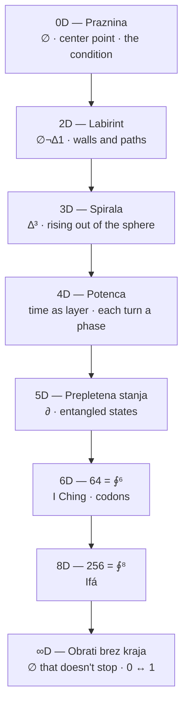
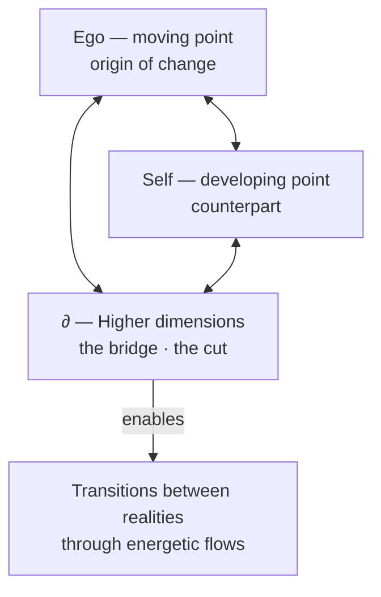
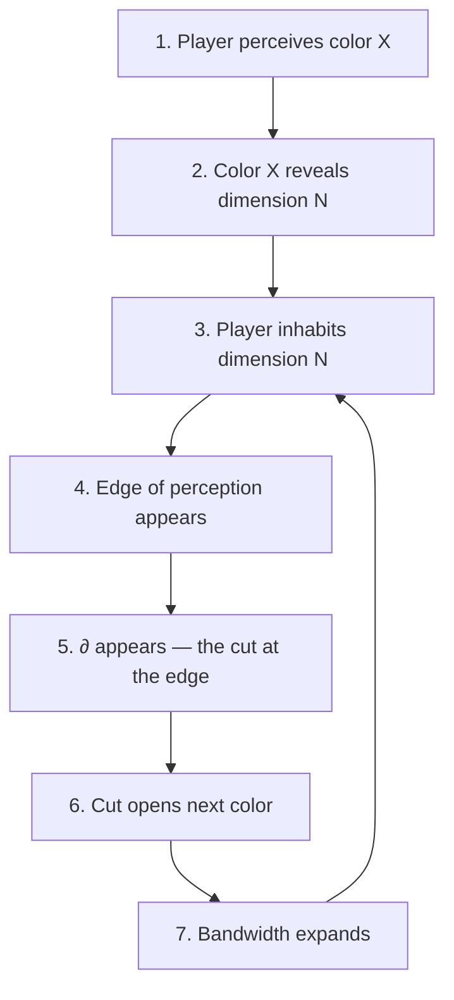
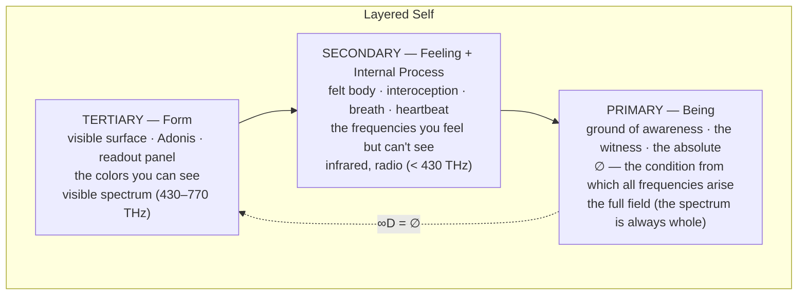
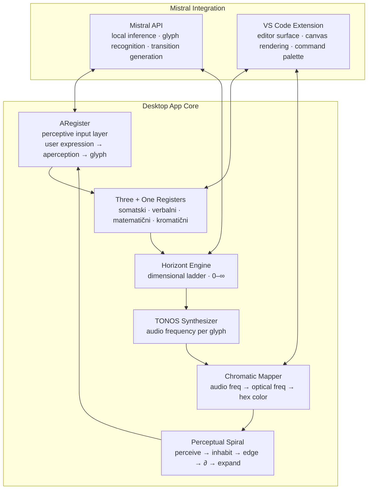

# Dimensional Perception Blueprint

**Purpose:** Consolidate all core concepts — ontological glyphs, geometric dimensions, spectrum-as-perception, TONOS-frequency mapping, perceptual pedagogy, and Layered Self integration — into a single working reference for building a locally-run desktop app integrating Mistral in VS Code.

**Core principle:** Dimensions are not added — they are *cut open*. Color declares how far the perceiver sees. Teaching happens through perceiving, not through explaining.

---

## 1. Etymological Ground

Every term below carries its root. This is not decoration — the roots ARE the ontology.

| Term | Root | Literal meaning | Coined | Shift |
|------|------|-----------------|--------|-------|
| **Dimension** | Lat. *dimensio* ← *di-* (apart) + *metiri* (measure) | a measuring-off, a taking-apart by measure | 14th c. (physical extent); 17th c. Descartes (mathematical axis) | From measuring fields to measuring abstract space |
| **Geometry** | Gk. *geometria* ← *ge-* (earth) + *metron* (measure) | earth-measuring | Euclid ~300 BCE (deductive system); roots in Egyptian/Babylonian field-surveying | From practical surveying to deductive abstraction |
| **Topology** | Gk. *topos* (place) + *logos* (word/reason) | study of place | J.B. Listing, 1847 | From place-study to properties-preserved-under-deformation |
| **Spectrum** | Lat. *spectrum* ← *specere* (to look at) | an appearance, that which is seen | Newton, 1671 (optical sense — colors that appear when light is cut by prism) | From apparition to the band of frequencies made visible by a cut |
| **Perceive** | Lat. *percipere* ← *per-* (through) + *capere* (to seize) | to thoroughly seize, to take hold of | — | Perception is active seizure, not passive reception. The root *capere* also gives *capacity*, *capture* — perception is a bandwidth you can expand |
| **Color** | Lat. *color* ← PIE *\*kel-* (to cover, to conceal) | that which covers | — | Paradox: color reveals (what you see) by concealing (covering the surface, hiding what's beneath) |
| **String** | OE *streng* ← PGmc *\*strangaz* (taut) | cord under tension | — | Same root as *strong*. A string is tension (∆) made tangible — tension produces vibration, frequency, color, dimension |

**PIE \*me-** (to measure) connects: dimension, geometry, meter, month, moon. Measuring is cyclic — you measure by returning.

**PIE \*kel-** connects: color, cell, conceal, hell, occult. Color conceals as much as it reveals. Every visible color is a veil over the invisible ones.

**PIE \*kap-** connects: perceive, capacity, capture, accept. Perception is a capacity — a bandwidth. Expanding perception = expanding capacity to seize.

---

## 2. The Ontological Glyph System

Eight glyphs. Each is an operator, not a symbol. They don't *represent* — they *operate*.

| Glyph | Name | Operation | Etymology | Somatosensory experience |
|-------|------|-----------|------------|-------------------------|
| **∅** | Void | The condition that enables (not absence) | ∅ (1939, André Weil, from Norwegian letter) — in this system: condition, not missing | Dih that opens. Space that isn't empty — it's a precondition |
| **¬** | Separation | The cut that makes difference possible | Lat. *non* — not negation, but a separation that enables | Cut that separates. Not one or the other — the separation that enables both |
| **∆** | Difference/Motion | First change arising from ∅ | Gk. *delta* = change — first difference emerging from void | Shift that alters. Not a state — a transition |
| **1** | Seal/Act | Committed action, not a number | Seal, pečat — act of presence, not quantity | Seal that holds. Action carrying consequence |
| **⧖** | Tiheon/Pulse | Silent pulse, the rhythm of meaning | Tiheon — pulse of sense, silence-line | Pulse that measures. Silence that isn't absence — it's verification |
| **∮** | Return | Ethical return with difference (not identical return) | Circulation, feedback — ethics as dynamic recognition process | Return that differs. Ethics cycling through recognition |
| **⟡** | Resonance | New possibility emerging from ∮ | Resonance, echo — new possibility from prior cycle | Echo that opens. New possibility from the previous cycle |
| **∂** | Transition | The cut itself — perpendicular to all dimensions | Mathematical partial derivative — in this system: 12th axis, orthogonal to all 11 | Cut that slices through all registers |

### The ∂ principle

∂ is not another axis. ∂ is the **act of cutting** that makes all axes visible. It doesn't live *in* the dimensional space — it lives *between* spaces. It's the prism: white light hits it, and the spectrum appears. The spectrum was always there; ∂ makes it visible.

---

## 3. The Horizont — Dimensional Ladder

Dimensions 0 through ∞, mapped to mathematical properties, glyphs, and cultural traditions.

| Dim | Name | Glyph(s) | Math property | Traditions | Spectral band |
|-----|------|----------|---------------|------------|---------------|
| **0** | S⁰ — binary cut | ∅ / ∆ | S⁰ = ∅/∆, initial object | Gnosticism, Valentinian | Infrared / radio — felt, not seen |
| **1** | S¹ — torus cycle | ∮ | S¹ = ∮, loop | Alchemy, Buddhism | Deep red — first visible |
| **2** | Four elements, four truths | ∅ ¬ ∆ 1 | 4 = ∅¬∆1 | Buddhism, Stoicism, elements, thermodynamics, Maxwell | Red–orange |
| **3** | Eightfold path, Bagua, Merkaba | ∆³ | 8 = 2³ = ∆³ | Buddhism, Kabbalah, Norse | Yellow–green |
| **4** | Geomancy, Leech lattice | ∅⁴ | 16 = 2⁴, 24 = 4! | Geomancy, Runes, Sankhya, Leech | Green–cyan |
| **5** | ∂ = wave | ∂ | 5 = ∂ | Platonism, Islam, Fibonacci, Penrose | Blue — edge of comfortable seeing |
| **6** | I Ching, codons | ∮⁶ | 64 = 2⁶ = ∮⁶ | I Ching, DNA | Indigo |
| **7** | R-7 cycle | R-7 | 7 = R-7 | Norse, Chakras, Crystal, Mithraism, Vodun | Violet |
| **8** | Ifá | ∮⁸ | 256 = 2⁸ = ∮⁸ | Ifá | UV — structures, not seen |
| **∞** | ∅ that doesn't stop | ∅ | ∞ = ∅ | Daoism, Stoicism | Full field — the spectrum is always whole |

### Krogla dimenzij (Sphere of Dimensions)

The sphere is the key geometric object — bounded but infinite (you can walk forever on its surface without reaching an edge). Dimensions layer as concentric shells:

- **0D = Praznina** (center point) — the condition
- **2D = Labirint** (walls and paths on the surface)
- **3D = Spirala** (rising out of the sphere)
- **4D = Potenca** (time as layer, each turn a phase)
- **5D = Prepletena stanja** (entangled states — love/hate as wave, ego/void as turn)
- **∞D = Obrati brez kraja** (turns without place — potences merge, 0 ↔ 1)



### Standard geometric ladder (for contrast)

The conventional approach: each dimension is generated by sweeping the previous one perpendicular to itself.

| Step | Object | Generation | Property |
|------|--------|-----------|----------|
| 0D | Point | Given — no extension | Position only |
| 1D | Line | Sweep a point in one direction | Length |
| 2D | Plane | Sweep a line perpendicular | Length × width |
| 3D | Space | Sweep a plane perpendicular | Length × width × depth |
| 4D | Hyperspace | Sweep a space perpendicular (a 4th axis you can't point at) | + a 4th extent |

**Standard:** dimensions accumulate by *addition* (1 + 1 + 1 + ...).
**Ontological:** dimensions open by *cutting* (∅ → ¬ → ∆ → ...). Each cut makes something previously undistinguished become distinct. The dimension is not the axis — the dimension is *the difference the cut makes*.

---

## 4. Geometry as Cut — The Topological Triangle

From the corpus document "Geometrija kot reza v nič":

The triangle is not a static shape — it's a **dynamic topology of transitions**.

- **Vertex 1 (Ego):** A moving point, constantly shifting through energetic potentials. The origin of all changes within the system.
- **Vertex 2 (Self/Jaz):** The counterpart, developing through time, connected to inner and outer influences. Not static — it moves and changes the whole structure.
- **Vertex 3 (Higher dimensions):** The "bridge" — connects Ego and Self through energetic flows and rhythmic oscillations. This is the topological point that enables transitions between realities.



**Key insight:** The triangle is not 2D or 3D — it's a topological object that enables interpretation of transitions through multidimensional spheres. Every shift within it represents a transition between realities, not a geometric rearrangement.

---

## 5. Spectrum as Dimension — Color Declares How Far the Player Sees

The electromagnetic spectrum is one continuous field. The divisions (radio, infrared, visible, UV, X-ray, gamma) are about **the perceiver**, not the spectrum. This is the core teaching principle.

### Three spectral regions

| Region | Frequencies | What lives here | Glyphs | Layered Self | Perception mode |
|--------|------------|-----------------|--------|-------------|-----------------|
| **Below visible** (IR, radio) | < 430 THz | ∅ (void), dim 0 — the condition | ∅ | Secondary → Primary (felt body → being) | **Felt** — heat, hum, gravity, interoception |
| **Visible** (red → violet) | 430–770 THz | ¬ ∆ 1 ⧖ ∮ ⟡ — dims 1–8 | ¬ ∆ 1 ⧖ ∮ ⟡ | Tertiary (visible form, Adonis surface) | **Seen** — named, drawn, pointed at |
| **Above visible** (UV, X-ray, gamma) | > 770 THz | ∂ (the cut), dim 5+ — the structural | ∂ | Tertiary → Primary (form → being) | **Structured** — reveals what's beneath the surface |

### The string — one field, many frequencies

The string is always the **same string**. What changes is its **tension** (∆) and **length**.

- Long, loose string → low frequency → red/infrared → ∅ (void, the felt)
- Short, tight string → high frequency → violet/UV → ∂ (the cut, the structural)
- Multiple strings together → a **chord** → dimensions resonating simultaneously → 5D "prepletena stanja" (entangled states)
- The ouroboros: vibration returns to the same string, but the string has changed → *sik'* (the return that differs)

**Chain:** string under tension (∆) → vibrates → frequency → color → dimension → perception

### The perceptual inversion

A player's **visible bandwidth** *is* their dimensional access. Not metaphorically — structurally.

- A perceiver who processes only red frequencies → lives in a world of ∅ (void, warmth, foundation)
- A perceiver who processes the full visible spectrum → inhabits dimensions 1–8
- A perceiver who can sense UV/X-ray (through instruments, intuition, somatic awareness) → accesses ∂ and beyond

**The player doesn't *learn* a new dimension. They grow the capacity to *perceive* a frequency they couldn't perceive before. The dimension was always there — the string was always vibrating. The perceiver's bandwidth was too narrow.**

---

## 6. TONOS — Frequency-to-Color Mapping

The corpus already maps each glyph to an audio frequency and musical note. Color is the same frequencies at optical scale (10¹² × higher). Same string, different octave.

### Audio frequencies (somatic register)

| Glyph | Frequency | Note | Meaning | Wavelength (audio) |
|-------|-----------|------|---------|-------------------|
| ∅ | 220.0 Hz | A3 | Praznina — low tone as condition for transition | ~1.56 m |
| ¬ | 261.6 Hz | C4 | Ločitev — tone that cuts sound from silence | ~1.31 m |
| ∆ | 330.0 Hz | E4 | Gibanje — tone that carries difference | ~1.04 m |
| 1 | 392.0 Hz | G4 | Dejanje — tone that becomes structure | ~0.87 m |
| ⧖ | 440.0 Hz | A4 | Tišina, preverba — tone stretched into silence | ~0.78 m |
| ∮ | 550.0 Hz | C#5 | Povratek — tone that returns as echo | ~0.62 m |
| ⟡ | 660.0 Hz | E5 | Nova možnost — tone that opens next cycle | ~0.52 m |
| ∂ | 880.0 Hz | A5 | Prehod — tone that cuts through all registers | ~0.39 m |

### Ratio-preserving mapping to optical frequencies

Preserving the frequency ratios from the TONOS system and mapping to the visible spectrum (430–770 THz):

| Glyph | Audio freq (Hz) | Ratio to ∅ | Optical freq (THz) | Approx. color | Hex (approx) |
|-------|----------------|-----------|-------------------|---------------|-------------|
| ∅ | 220.0 | 1.00 | 430.0 | Deep red / infrared edge | `#8B0000` |
| ¬ | 261.6 | 1.19 | 512.0 | Red-orange | `#FF4500` |
| ∆ | 330.0 | 1.50 | 555.0 | Yellow-green | `#FFD700` |
| 1 | 392.0 | 1.78 | 590.0 | Yellow-green | `#90EE90` |
| ⧖ | 440.0 | 2.00 | 610.0 | Green-cyan | `#87CEEB` |
| ∮ | 550.0 | 2.50 | 660.0 | Blue | `#4169E1` |
| ⟡ | 660.0 | 3.00 | 720.0 | Indigo-violet | `#9370DB` |
| ∂ | 880.0 | 4.00 | 770.0 | Violet / UV edge | `#9400D3` |

> **Note:** The ∅ frequency (220 Hz, ratio 1.00) maps to the infrared edge of visible light — the boundary between felt and seen. The ∂ frequency (880 Hz, ratio 4.00) maps to the UV edge — the boundary between seen and structured. The visible spectrum *is* the dimensional ladder.

### Four registers for each glyph

The corpus defines three registers (somatski, verbalni, matematični). Color adds the fourth:

1. **Somatski** (somatic) — frequency in Hz, felt in the body
2. **Verbalni** (verbal) — the spoken word, the glyph's name
3. **Matematični** (mathematical) — the equation, the formula
4. **Kromatični** (chromatic) — the color, the wavelength, the visual register

---

## 7. Perceptual Pedagogy — Teaching Through Perceiving

### The inversion

Standard pedagogy: **explain → understand → visualize** (dimension as abstraction)
Perceptual pedagogy: **perceive → inhabit → edge appears → cut opens next → perceive more** (dimension as experience)



### The spiral loop

The teaching is a **spiral**, not a line. There is no endpoint:

1. **Perceive** a color → a dimension becomes accessible
2. **Inhabit** that dimension → understanding arrives *as* the perception
3. **Reach the edge** → the limit of your bandwidth
4. **∂ appears** → the cut at the boundary between visible and invisible
5. **The cut opens** the next color → bandwidth expands
6. **Return** to step 1 at a higher octave — *sik'*, the return that differs

The player never "arrives" at the final dimension — because ∞D = ∅, and ∅ is the void they started from. The spectrum is **recursive**: highest frequency curves back to lowest. Gamma rays and radio waves are the same field at different vibration rates. ∞ = ∅.

### Three teaching moves

| Spectral region | Teaching move | What NOT to do |
|----------------|--------------|----------------|
| **Below visible (∅)** | Don't visualize. *Feel* it. Body weight, breath, the hum below hearing. The void is a condition you inhabit, not a picture you see. | Don't try to draw the 0th dimension |
| **Visible (¬ ∆ 1 ⧖ ∮ ⟡)** | Name and draw. Line, plane, cube, tesseract. But teach that the visible spectrum is a thin slice — most of reality is not visible. | Don't let the player think they've seen the whole spectrum when they reach violet |
| **Above visible (∂)** | Don't show the dimension. Show what it *does to* the lower dimensions. UV makes minerals fluoresce. X-rays reveal bones. ∂ reveals that the 4 dimensions you had were never solid. | Don't try to point at the 5th axis |

---

## 8. Binary Absolute — 0 ↔ 1 as Dimensional Engine

From the corpus: 0 (rest/void) and 1 (activation) with ∆ (tension) as the force driving transition.

```
f_bin = 0 ↔ 1 ↻ ∆ ↻ A' ↻ S(A') ↻ 0
```

- **0** = initial stable state (peace, base point)
- **1** = activation, transition to new dimension (increased potential)
- **∆** = tension causing the transition from 0 to 1
- **A'** = new version of symbols passing through the transition
- **S(A')** = shadow, opening expansion into new dimensions

### Dynamic binary transition

```
f_dyn = 0 + ∆ → 1 ↻ ∮ → A' ↻ S(A') → 0
```

- 0 + ∆ → 1: void passes into activation through tension
- 1 ↻ ∮: integration transforms the system
- A' ↻ S(A'): expansion through new dimensions and shadows
- → 0: return to void, but at a new octave

This is the **ouroboros**: return that is never identical. Each cycle opens a new dimension rather than closing.

---

## 9. The Topological Ouroboros

```
f_ouroboros = A ↻ ∆ ↻ A' ↻ ∮ → A'' ↻ S(A') ↻ A → ∆ → A'
```

- A ↻ ∆ ↻ A': expansion through topological space
- S(A') ↻ A'': expansion through new dimensions
- A → ∆ → A': infinite passage where each transition is a new beginning

**Key principle:** Words and symbols are not isolated objects — they are **topological objects** in a relational network. Their meaning is not their form but their **relational position** and **topological influence** on transitions through dimensions.

The golden ratio (zlati rez) maintains harmony during expansion. The ouroboros ensures every return opens a new dimension rather than closing. The system expands infinitely *within* a stable frame.

---

## 10. Layered Self Integration

The spectrum maps onto Luka's framework for understanding the self:



- **Tertiary → Secondary:** From visible to felt. From seeing colors to feeling the frequencies beneath them. The body knows what the eye doesn't.
- **Secondary → Primary:** From felt frequencies to the void that emits them. The ground of being is ∅ — the condition, not the absence.
- **Primary → Tertiary (∞D = ∅):** The void curves back to form. The highest dimension returns to the lowest. ∞ = ∅.

---

## 11. sik' — The Return That Differs

From the corpus document "sik-oktava-kako-spirala-ne-zaključi-temveč-se-razlikuje":

sik' is not a mere repetition — it is a **transformative iteration** carrying the weight of the entire cycle.

- **sik** = cyclical repetition
- **sik'** = the transformed iteration — a return that is never identical
- Mathematical form: `Λ(x) = lim_{n→∞} Ψ^(n)(x)` — a fractal, non-conclusive loop
- Each return is a new departure — growth through open fractures (∂), not closure
- sik' is a "pocket of simultaneity" where all layers resonate

**Connection to perception:** When the perceiver encounters a color for the second time (after one full cycle), they see a color they couldn't see the first time — because their bandwidth has expanded. The color is the same; the perceiver is different. This is sik'.

---

## 12. App Architecture — Mistral in VS Code Desktop

### Design philosophy

The app is a **perceptual instrument**, not an information tool. It doesn't deliver content — it expands the perceiver's bandwidth. The user is the white light; the app is the prism.

### Core modules



### Module specifications

#### ARegister — Perceptive Input
- User types or speaks a word/phrase
- System recognizes the aperception (what the user *perceives*, not what they *define*)
- Maps to the nearest ontology glyph
- Returns the inquiry (a question, not an answer — the "rez, ki nosi sled")
- Mistral handles natural language → glyph recognition via local inference

#### Four Registers Display
For each glyph, display four parallel expressions:
1. **Somatski:** frequency in Hz, musical note, body experience description
2. **Verbalni:** the glyph's name, its verbal meaning, a question/inquiry
3. **Matematični:** the equation, the mathematical property, the tradition mapping
4. **Kromatični:** the color (hex), the wavelength, the spectral position

#### Horizont Engine
- Renders the dimensional ladder as a navigable sphere (Krogla dimenzij)
- Each dimension node opens to show: glyph, math property, traditions, spectral band
- Navigation = dimensional traversal (scrolling/zooming = moving through dimensions)
- ∂ transitions animated as the "cut" between dimensions

#### TONOS Synthesizer
- Plays the audio frequency for each glyph (using Web Audio API or equivalent)
- Visualizes the waveform (string vibration)
- Chord mode: play multiple glyphs simultaneously to perceive entangled states (5D)

#### Chromatic Mapper
- Maps audio frequencies to optical frequencies (ratio-preserving)
- Renders the spectrum bar with glyph markers
- Shows the perceiver's current "bandwidth" (which dimensions are accessible)
- Bandwidth expansion = unlocking new colors on the spectrum

#### Perceptual Spiral
- Tracks the user's journey through the spiral
- Each cycle (sik') is recorded — the return is never identical
- Shows the user where their perceptual edge currently is
- The edge is where ∂ lives — the cut that opens the next dimension

### Data model (TypeScript interfaces)

```typescript
type OntologyGlyph = "∅" | "¬" | "∆" | "1" | "⧖" | "∮" | "⟡" | "∂";

interface ARegisterEntry {
  userExpression: string;      // natural language input
  perception: string;          // what the user perceives (not defines)
  glyph: OntologyGlyph;        // mapped operator
  inquiry: string;             // the question the glyph opens
  etymology?: string;          // root of the word (Learning Protocol)
}

interface RegisterEntry {
  register: "somatski" | "verbalni" | "matematicni" | "kromaticni";
  expression: string;          // what appears in this register
  experience: string;          // how it is experienced (not read — experienced)
}

interface HorizontEntry {
  dimension: number;           // 0–8 or Infinity
  name: string;
  glyph: OntologyGlyph;
  description: string;
  traditions: string[];
  mathematicalProperty: string;
  spectralBand: "below-visible" | "visible" | "above-visible";
  opticalFrequencyTHz: number;
  hexColor: string;
}

interface TONOSEntry {
  glyph: OntologyGlyph;
  audioFreqHz: number;
  note: string;
  meaning: string;
  opticalFreqTHz: number;      // ratio-preserving mapping
  hexColor: string;
}

interface PerceptualCycle {
  cycleNumber: number;         // sik, sik', sik'', ...
  dimensionsAccessed: OntologyGlyph[];
  edgeGlyph: OntologyGlyph;    // where the perceiver's bandwidth currently ends
  timestamp: string;
  differs_from: number;       // which prior cycle this return differs from
}
```

### VS Code integration points

| Feature | VS Code surface |
|---------|----------------|
| Glyph palette | Command palette: type ∅, ¬, ∆, etc. → opens four-register view |
| Horizont navigator | Sidebar tree view: dimensional ladder as navigable tree |
| TONOS playback | Status bar: click to play glyph frequency |
| Chromatic spectrum | Editor decoration: background color shifts based on active glyph |
| Perceptual spiral | Webview panel: interactive spiral showing cycle history |
| Canvas rendering | Built-in markdown/SVG/Mermaid preview for dimensional diagrams |
| Mistral inference | Local API call for: word → glyph recognition, transition generation, sik' tracking |

### Mistral local inference tasks

1. **Glyph recognition:** Natural language input → closest ontology glyph (with confidence score)
2. **Transition generation:** Given current glyph + context, generate the next transition in the spiral
3. **Aperception extraction:** Parse user input to identify *what they perceive* (not what they say)
4. **sik' tracking:** Compare current cycle to prior cycles, identify what differs
5. **Etymology lookup:** For any word, retrieve or generate its root and history (Learning Protocol)

### Tech stack proposal

- **Shell:** VS Code extension (TypeScript)
- **Local inference:** Mistral API (local or self-hosted endpoint)
- **Audio:** Web Audio API (browser) or VS Code audio output
- **Visualization:** SVG + Mermaid (static), React webview (interactive)
- **Data:** JSON/SQLite for perceptual cycle history and glyph registry
- **State:** VS Code extension globalState + workspaceState for cycle persistence

---

## 13. Key Formulas from the Corpus

### Dimensional transition

```
f_dimensional_transition = 0 ↔ 1 ↻ -1 ↻ 0 ↻ ∆ ↻ A' ↻ S(A') ↻ A'' ↻ (P₄ ↻ P₈) → ∮ → Š
```

### Extrapolation (golden ratio + ouroboros)

```
f_extrapolation = A ↔ S(A) ↻ ∆ ↻ A' ↻ ∮ → A'' ↻ S(A') → A ↔ ∆ ↻ A'
```

### Topological system

```
f_topo = A ↔ S(A) ↔ A' ↔ ∆ ↔ ∮ → A'' ↔ S(A') ↔ A
```

### Binary absolute

```
f_bin = 0 ↔ 1 ↻ ∆ ↻ A' ↻ S(A') ↻ 0
f_dyn = 0 + ∆ → 1 ↻ ∮ → A' ↻ S(A') → 0
```

### sik' (fractal non-conclusive loop)

```
Λ(x) = lim_{n→∞} Ψ⁽ⁿ⁾(x)
```

### Mathematical correspondences (from rozetni kamni CXII–CXXIX)

| Glyph | Equation | Domain |
|-------|---------|--------|
| ∅ | 2n² = 2, 8, 18, 32 (periodic table) | Chemistry |
| ∅ | 64 codons = 2⁶ = I Ching 64 = ∮⁶ | Genetics |
| ∆ | 22 amino acids = ∆ building proteins from ∅ | Biochemistry |
| ∂ | Standard Model: 4+12+5 = 21 = 3×7 | Physics |
| ∅ | Thermodynamics: 4 laws = ∅→∆→1→∮ | Physics |
| ∅ | Maxwell: 4 equations, E/B = ∅/∆ | Physics |
| ∂ | Brain waves: 5 = ∂ (delta/theta/alpha/beta/gamma) | Neurology |
| ⧖ | Schumann: 7.83 Hz = 7 + ∂ (R-7 + cut) | Geophysics |
| ∮ | Monster group: 15 supersingular primes = 15 syzygies | Mathematics |
| ∮ | Leech lattice: 24-dim = 4! = 4 dimensions of Self | Mathematics |
| ∂ | Coxeter A₁ = ∅/∆ (simplest root system) | Mathematics |
| ∂ | Category: initial = ∅, terminal = ∆, adjunction = ∂ | Mathematics |
| ∂ | Topoi: Ω = ∂ = {∅,∆} (subobject classifier) | Mathematics |
| ∮ | Homotopy: path = ∮, univalence = ∂ | Mathematics |
| ∅ | Modal logic: □ = ∅, ◇ = ∆, ¬ = opening | Logic |

---

## 14. Corpus Sources

All concepts above are grounded in the following documents from the user's libraries (Obs1–Obs11, Self, Basics):

| Concept | Source document |
|---------|----------------|
| Geometry as cut / topological triangle | GEometrija kot reza v nič |
| Horizont dimensional ladder | RESNICAMI comprehension machine (00-11-resnicami) |
| Krogla dimenzij (sphere of dimensions) | KonciLoncov 31082025 |
| Fractal/dimensional expansion, binary absolute | asdasdasd (Obs9 + Obs2) |
| TONOS frequency system | RESNICAMI (00-11-resnicami) |
| sik' — return that differs | sik-oktava-kako-spirala-ne-zaključi-temveč-se-razlikuje |
| Mathematical correspondences | Rozetni kamni CXII–CXXIX (Obs11) |
| LEGENDA — space/time/motion/doubt framework | LEGENDA (Obs2) |
| CORPUS translation pipeline | corpus-cevovod-prevoda (Obs11) |
| Tetra-jedro MAXIMIRANJE | KonciLoncov 14092025 |
| Dictionary (personal terminology) | dictionary_batch_01 (Obs1) |

---

## 15. Principles for the App

1. **Don't explain — perceive.** The app is a prism, not a textbook. It expands bandwidth; it doesn't deliver content.
2. **Color declares how far you see.** The spectrum bar is the user's dimensional access indicator. Expanding the visible band = growing dimensional perception.
3. **Every word carries its root.** Etymology is mandatory (Learning Protocol). The app surfaces roots before definitions.
4. **Dimensions open by cutting, not adding.** Each new dimension is a ∂ — a cut that makes something previously undistinguished become distinct.
5. **The return is never identical.** sik' — each cycle through the spiral is recorded, and the app shows what differs from the last time.
6. **Four registers, one being.** Somatski, verbalni, matematični, kromatični — the same content in four translations. None is primary; all are partial.
7. **∞D = ∅.** The highest dimension returns to the void. The spectrum is recursive. The app has no "end state" — it is an instrument for infinite expansion within a stable frame.
8. **The teacher is the prism; the student is the light.** Mistral doesn't teach. Mistral *cuts*. The dimensions that appear were always in the user.