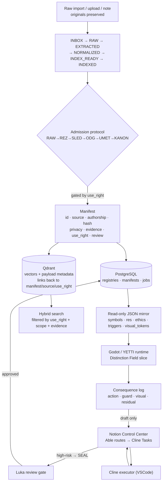

# Comprehension Machine · 26 Symbiosis Answers

> These answers are not generic defaults. They are reverse-engineered from your actual ONTOMATEMATIKA Control Center, the Cline Knowledge Base, the Corpus Canon Audit, the Data/Resource Integration Map, the Label→Trigger production spec, and the Able–Mistral–Cline delegation protocol. Where your project already decided something, that decision is stated as the answer. Where it is still open, I mark it **(open — choose)** and give a recommended option that fits the rest of the system.

## How the real system is shaped (the spine you already built)



---

## 📥 PIPELINE DESIGN

### 1. Primary ingestion method? — **Both + API**
Your corpus is already a mix: imported Notion topics, Google Drive files (`ONTOMATEMATIKA.md`, the `ENAomega_bundle_v1.zip`, `EXPERIMENT.md`), Obsidian vaults (Obs1–Obs11), and future philosophical notes / dream-image / code-idea inputs. The Data/Resource Integration Map Layer C defines a *single* admission path for all of them: `raw material → Document → extraction → candidates → scope check → registry placement → game translation → implementation proposal → review`. So: file upload, corpus import, and an API/programmatic push (Cline Tasks pushing extracted candidates) all feed the same intake.

### 2. Processing flow? — **Sequential, gated (selective)**
The Corpus Canon Audit makes this explicit: a candidate **cannot advance** unless authorship is known, private material stays scoped, assistant projection is separated from user text, factual claims have evidence, metaphor isn't disguised as fact, the counter-position is recorded, technical material is retested, registry compatibility is checked, and a residual stays visible. That is a strictly ordered, gated pipeline — `RAW → REZ → SLED → ODG → UMET → KANON` — where each stage has a required outcome and a human gate at KANON. Parallelism is fine *within* a stage (batch extraction), but stages do not skip.

### 3. Storage matrix — Where does each data type go?
| Data type | Store | Why |
|---|---|---|
| Originals / raw files | Object/file store, **unchanged** | "Originals are evidence. Correction creates a new trace; it does not silently repair history." |
| Manifests (id, source, authorship, hash, privacy, evidence, use_right, review state, related sources) | **PostgreSQL** | Relational, queryable registries (symbols, RES, axioms, problems, agents, ethics, documents, Cline Tasks) |
| Vectors + payload metadata | **Qdrant** | Your own words: *"Qdrant ni raw korpus. Qdrant je indeksirani spomin — izpeljani vektorji + payload metadata + povezave nazaj na manifest / source id / use_right."* Qdrant never holds raw material, only derived vectors that point back to the manifest. |
| Runtime game data | **Read-only JSON mirror** (`symbols.json`, `res_units.json`, `ethics_rules.json`, `restriction_pipeline.json`, `visual_tokens.json`, `slice_manifest.json`) | Godot consumes a curated export — no live writes at runtime |
| Hot runtime state / consequence buffer | **Redis** *(open — choose)* | For the consequence log buffer and fast Guard lookups; not yet specified in your docs |
| Governance / task state | **Notion** (Control Center, Cline Knowledge Base, Cline Tasks) | The command surface and authoritative registry |

### 4. Embedding strategy? — **Chunked (semantic), manifest-linked**
Chunked embeddings, because Qdrant stores *derived* vectors with payload metadata pointing back to the manifest/source id/use_right — not whole-document or no embeddings. Every chunk inherits the use_right and evidence label of its parent manifest, so retrieval can never outrun its permission.

### 5. Embedding model? — **(open — choose) · recommended: local via Ollama**
Your execution model is local-first (Cline runs locally, the archive references Docker/Ollama/GPU setups, and `topic_14_docker_ollama_py` exists). To keep the whole pipeline self-hostable and private, run the embedder locally through Ollama. Recommended candidates: **`nomic-embed-text`** (fast, multilingual-friendly, good for Slovenian/English mixed corpus) or **BGE-m3** (strong multilingual, larger). MiniLM-L6 is too weak for the mixed-language philosophical corpus. Mark this as a Cline Task: benchmark nomic vs BGE-m3 on a 5-pilot-resource set before locking it.

---

## 🔄 WORKFLOW ORCHESTRATION

### 6. N8N as primary orchestrator? — **Hybrid (delegation loop is the authority; N8N automates the mechanical parts)**
You already have an orchestrator: the **Able–Mistral–Cline delegation loop**. Able decides the next work unit and writes it into Cline Tasks; Cline executes local file changes; Mistral does reasoning/code-support passes; Luka reviews high-risk ontology/ethics/kernel/SEAL decisions. That loop is the *authority*. N8N should be the *automation substrate* for the deterministic, repeatable steps (watch a Drive/Notion folder, trigger extraction, run the RAW→…→INDEX_READY moves, sync the JSON mirror) — not the decision-maker. So: N8N for mechanics, Able/Cline/Luka for judgment.

### 7. What workflows needed? — **Ingestion + Sync + Validation + Consequence-logging (Crawl later)**
- **Ingestion**: the admission protocol end-to-end (RAW→REZ→SLED→ODG→UMET→KANON) with use_right gating.
- **Sync**: Notion registry ↔ local read-only JSON mirror (the Data Integration Map says: mirror first, no live writes).
- **Validation (Guard)**: run restriction checks (ref, scope, contradiction, evidence, harm, non-erasure, Guard, Ω, SEAL) on every candidate before promotion.
- **Consequence logging**: `player action → interpreted answer → restrictions checked → pass/fail/review/STOP → visual consequence → residual → Notion feedback candidate`.
- **Crawling**: *(future)* — you listed web crawl; build it only after the ingestion + mirror path is stable.

### 8. Trigger mechanism? — **Webhook + Queue (Cline Tasks) + Cron for sync**
- **Webhook**: file dropped in Drive/Notion import folder → kick intake.
- **Queue**: Cline Tasks *is* your queue — each row has what/why/requirements/acceptance/code-location/prompt/context/executor/status. N8N reads "Ready" rows.
- **Cron**: periodic Notion→JSON mirror rebuild and registry-health audit.

---

## 🔍 SEARCH & RETRIEVAL

### 9. Search capabilities? — **Hybrid + Filtered (use_right is a hard filter, not a ranking signal)**
Hybrid (keyword + vector over Qdrant), but the defining requirement is **filtering**. Your canon audit states `INDEXED ≠ VERIFIED ≠ PERMITTED ≠ CANON` — "availability is not permission." Search must filter by **use_right** (`CAPTURE_ONLY`, `PRIVATE_REVIEW`, `PARAPHRASE_ALLOWED`, `WORKING_DOC_USE`, `CANON_CANDIDATE`, `CANON_USE`), by **authorship** (`USER_AUTHORED`/`ASSISTANT_AUTHORED`/`EXTERNAL_SOURCE`/`COMPOSITE`/`UNKNOWN`), by **evidence label**, and by **scope/ref-context**. A result that outruns its measured scope is forbidden: `claim.scope ⊆ receipt.measured_scopes`.

### 10. Search interface? — **REST API + UI (two surfaces)**
- **REST API** for the agent bridge (Cline/Mistral/Able querying the knowledge base) and for Godot at runtime.
- **UI** in two forms: the **Notion Control Center** as the human ops/search surface, and the **Workspace Perusal Engine** protocol for perusing the whole workspace without losing grounding/provenance/Guard/Residual.

### 11. Result format? — **Structured + Ranked + with a "shadow"**
Every result is structured (id, title, type, source_url, scope, ref_context, visual_token, interaction_rules, restriction_checks, allowed_states, residual_notes, implementation_status), ranked by relevance — and crucially **carries a shadow**: it must state both what was supported *and* what was not measured. Plus a residual field for what remains unresolved. Silence is preferable to invented coverage.

---

## 🖥️ FRONTEND

### 12. What should frontend display?
Your frontend is not a generic dashboard — it is three coordinated surfaces:
- **Godot / YETTI** (the playable runtime): Explorer + Search + Consequence, via the read-only JSON mirror. Tap → ask → answer → Guard check → visual consequence → residual.
- **Notion Control Center**: the ops Dashboard + Stats (Audit Dashboard = registry health; Cline Tasks = job queue; Cline Knowledge Base = implementation memory).
- **Grafana** *(open)*: throughput/latency/error/Guard-rate/Residual metrics over the pipeline.

### 13. Frontend priority? — **Fix existing (Godot slice) + read-only mirror first; Notion as ops UI; Grafana for metrics**
The Data Integration Map is explicit: *"Read-only mirror first. No live writes yet."* So the order is: (1) build the resource map + JSON mirror, (2) wire the existing Distinction Field slice to read the mirror and emit a local consequence log, (3) only then draft Notion feedback items, (4) Grafana observability last. Do not build a new web UI alongside Godot + Notion — that would duplicate the Control Center.

---

## 🗃️ DATA MODEL

### 14. Entities to store?
Documents, Knowledge objects (Symbols, RES Units, Axioms, Problems, Solution Pairs, Agents, Ethics rules), Embeddings, Sources, Jobs (Cline Tasks), Users (Luka = reviewer; Able/Mistral/Cline = agent identities), plus your governance entities: Guard, SEAL, Residual ℜ, Harm Budget, Non-Erasure, Ref-context, Evidence ⟡.

### 15. Entity relationships?
The resource spine from the Integration Map:
```
Document → extracted Symbol / RES / Problem / Axiom
        → related Agent / Ethics / Guard
        → possible Game Mechanic
        → Cline Task
        → Godot Feature
        → Test Result
        → Registry Feedback
```
Every manifest carries: stable ID, title, original source+location, authorship, import/creation dates, source type, content family, **hash** (identity receipt), extraction/normalization method, privacy class, evidence status, **use_right**, human-review state, related sources, superseding artifacts. Game Resource Dictionary rows link each source object to a game form, interaction verb, restriction checks, Godot representation, Cline task link, status (Seed→mapped→implemented→tested→unstable→sealed), and **Residual**.

---

## 📊 OBSERVABILITY

### 16. Key metrics? — **Throughput · Latency · Errors · Guard outcomes · Residual · Registry health**
Standard pipeline metrics plus the ONTOMATEMATIKA-specific ones: **Guard pass / block / review-required rates**, **Residual counts** (open vs false-closure), **use_right distribution** (how much is CANON vs CAPTURE_ONLY — canon is the bottleneck), **registry health** (missing sources, empty wrappers, duplicate material, superseded artifacts), and **evidence-shadow coverage** (claims whose measured scope is narrower than asserted).

### 17. Alert thresholds?
- **SEAL/Review-Required**: any action touching canon, identity, ethics, kernel, or irreversible schema → route to Luka (this is a *rule*, not a threshold).
- **>1% pipeline errors**, **Guard-block spike** (more blocks than passes in a window), **false-closure detected** (closure attempted on open Residual), **registry-health regression** (new missing/empty/duplicate). Latency/CPU/memory thresholds are secondary — see load answer below.

---

## ⚙️ INFRASTRUCTURE

### 18. Expected load? — **<100 docs/day**
This is a personal knowledge engine for one author (Luka) processing a finite imported archive (the audit ledger lists ~20 source topics + Obsidian vaults). Volume is small; the hard part is *judgment per item*, not throughput.

### 19. Scaling strategy? — **Manual / single-node**
No HPA or cluster autoscaler needed. Run one local stack (PostgreSQL + Qdrant + Redis + Ollama + Godot) via Docker Compose. Scale only if the crawl pipeline or a multi-agent future demands it.

### 20. Storage needs? — **10–100GB**
Corpus (PDFs, transcripts, vaults) + Qdrant vectors + Godot assets + the ENAomega bundle. Under 1 TB for the foreseeable scope.

---

## 🔐 SECURITY

### 21. Who accesses? — **Local + Internal (agents), single human**
Luka is the only human reviewer. "Users" are agent identities: Able (orchestrator), Mistral (reasoning), Cline (executor). External access is not intended.

### 22. Auth method? — **API-key/JWT for the agent bridge; local trust for humans**
The Cline↔Notion↔runtime bridge needs machine auth (API key / JWT) so N8N/Cline can call the search API and write Cline Tasks. The human surface (Notion, Godot, Grafana) runs on local-network trust. OAuth2 is overkill until you expose anything externally.

### 23. Data sensitivity? — **Highly sensitive**
Your own audit flags `PRIVATE QUARANTINE` (health/admin records), `PRIVATE / HARMFUL MIX`, and acute-state writing that must not be treated as biography. Article 9: crisis writing may support analysis of a moment, not a judgment of a person. This is the most sensitive tier — the use_right + authorship + privacy-class filters exist precisely because of it.

---

## 🚀 OPERATIONS

### 24. Deployment frequency? — **Manual (Cline-driven), review-gated**
Cline executes local file changes on demand; Able writes the next task; Luka reviews high-risk changes. There is no CD pipeline — deployment *is* the delegation loop.

### 25. Rollback strategy? — **Manual, git-backed (via Cline)**
Cline works in a git repo, so rollback = revert commits. Originals are never modified, so "rollback" for content means re-deriving vectors from the preserved raw trace, not restoring lost data.

### 26. Backup strategy? — **Original-preservation + daily snapshot**
Originals are immutable evidence (Article 1), which is itself a backup invariant. Add daily PostgreSQL dumps + Qdrant snapshots + the existing Google Drive bundle (`ONTOMATEMATIKA_ENAomega_bundle_v1.zip`). Point-in-time is nice-to-have; geo-redundancy is unnecessary at this scale.

---

## 🎯 5 IMPLEMENTATION GOALS — re-mapped to your real ladder

Your Data/Resource Integration Map already defines an implementation ladder. Here it is, aligned to the 5 goals:

| # | Goal | Your version | Success criteria |
|---|---|---|---|
| 1 | Document Ingestion Pipeline | **Admission pipeline**: import → RAW→REZ→SLED→ODG→UMET→KANON → manifest in PG → vectors in Qdrant, gated by use_right | A candidate reaches KANON only after authorship/evidence/scope checks pass; originals stay unchanged; Qdrant payload links back to manifest |
| 2 | Web Crawling Pipeline | *(later)* Crawl4AI → same admission path → store | Reuses goal 1; deferred until ingestion + mirror are stable |
| 3 | Unified Search API | **Hybrid + use_right-filtered search** returning structured results with evidence-shadow + residual | `INDEXED ≠ PERMITTED ≠ CANON` enforced; results never outrun measured scope |
| 4 | N8N Workflow Automation | **N8N mechanics under the Able–Mistral–Cline authority loop** | Ingestion/sync/validation/consequence workflows run with error handling; high-risk routes to Luka Review |
| 5 | Observability Dashboard | **Audit Dashboard (registry health) + Grafana + Consequence log** | Guard rates, Residual counts, use_right distribution, registry health visible; SEAL/Review alerts fire |

### Immediate next steps (from your own map)
1. Build the resource map (resource family → game role → implementation route → restriction gates).
2. Choose five pilot resources: ∆ Distinction, Ref-context, ⟡ Evidence, Guard, Residual ℜ.
3. Define the read-only JSON mirror (`data/ontomatematika/*.json`). No live writes yet.
4. Wire the existing Distinction Field slice to ask/answer + emit a local consequence log.
5. Add the consequence log; save locally first.
6. Registry feedback loop only after read-only export + local logs work: `local log → Able review → Notion draft → Luka confirmation → registry update`.

---

## Open decisions for you (Luka)
1. **Embedding model** — nomic-embed-text vs BGE-m3 (both via Ollama). Recommend benchmarking on the 5-pilot set.
2. **Redis** — confirm as the consequence-log buffer / hot Guard cache, or pick another.
3. **Grafana vs Notion-only observability** — is a separate Grafana stack worth it, or fold metrics into the Notion Audit Dashboard?
4. **GitHub** — your project clearly has a code repo (Cline edits local files, Godot, Docker/Ollama), but the GitHub connector here only exposes read-by-URI (no repo search). Share the repo URL and I'll read its structure and align the code-level answers to it.
5. **Crawl timing** — confirm web crawl stays deferred behind goals 1 + 3.

---

## Grounded in (sources consulted)
- ONTOMATEMATIKA Data/Resource Integration Map v0.1 — Notion Control Center
- Imported Corpus Constitution & Canon Audit v0.1 (RAW→REZ→SLED→ODG→UMET→KANON, use_right, evidence labels, 12 articles)
- Able–Mistral–Cline Delegation Protocol + PIPE-DELEGATION (Cline Knowledge Base)
- ONTOMATEMATIKA Label Definitions & Trigger Production v0.1 (definition→label→trigger→consequence)
- Qdrant-as-indexed-memory note (topic_15: vectors + payload metadata, not raw corpus)
- Workspace Perusal Engine v0.1 + Goal→Question→Task Map
- Google Drive: Ontomatematika project, ONTOMATEMATIKA.md, ENAomega_bundle_v1.zip, EXPERIMENT.md
- Self library: Katalog Modulov, Definirani tipi vnosov, Kalibracija, Zmožnosti (BIOS)